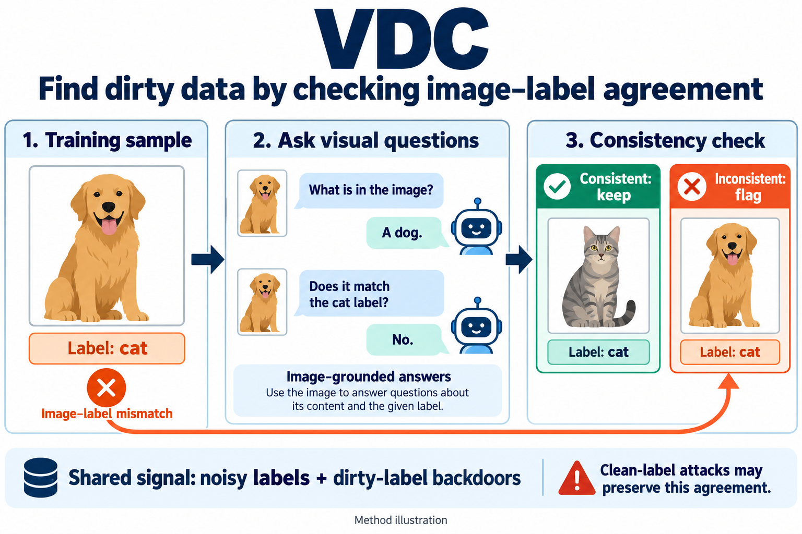
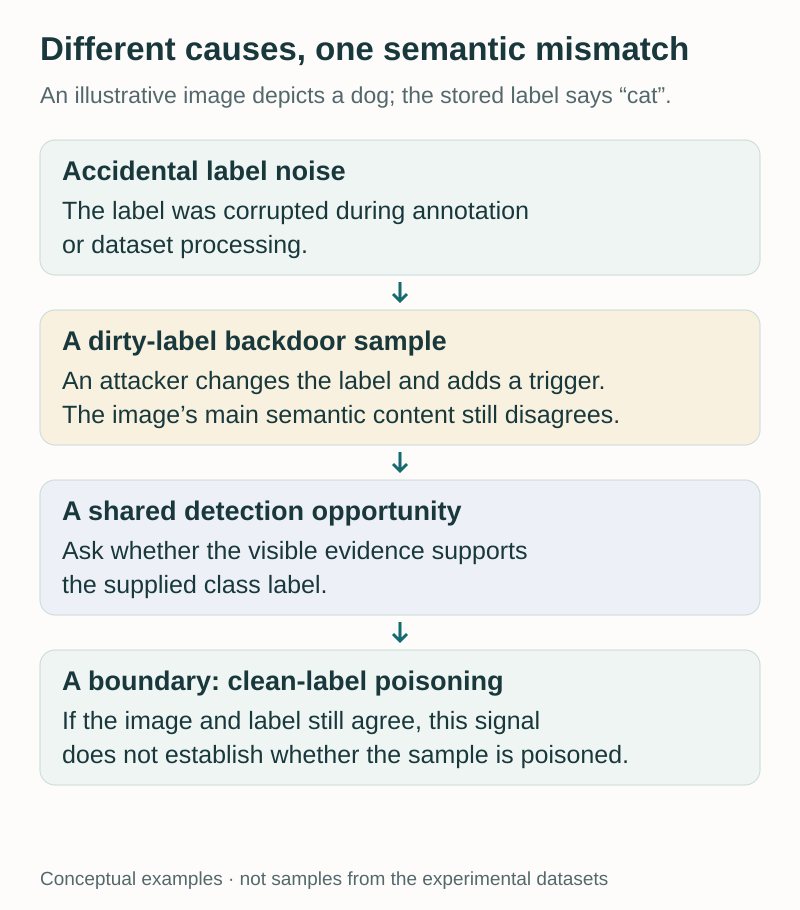
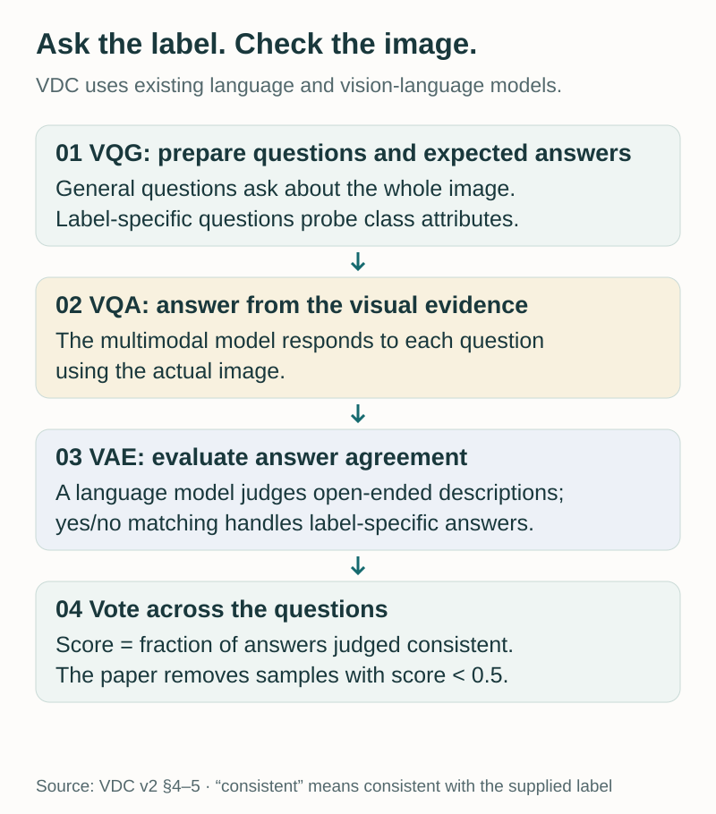
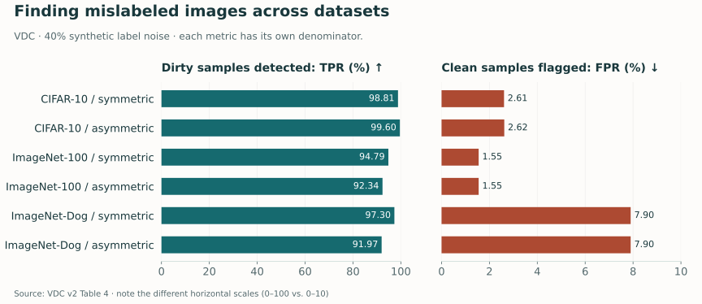
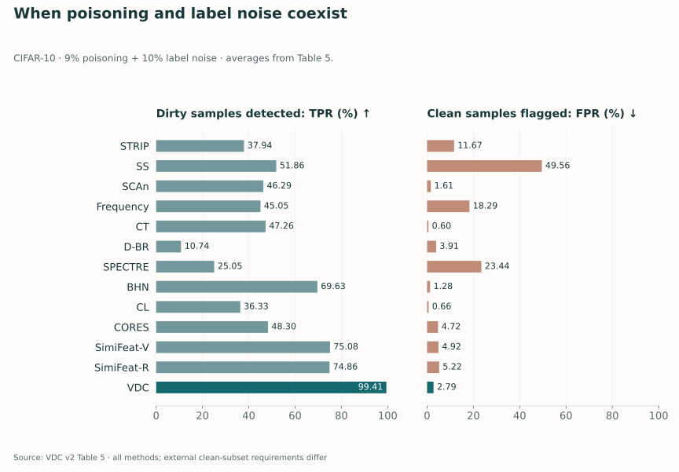
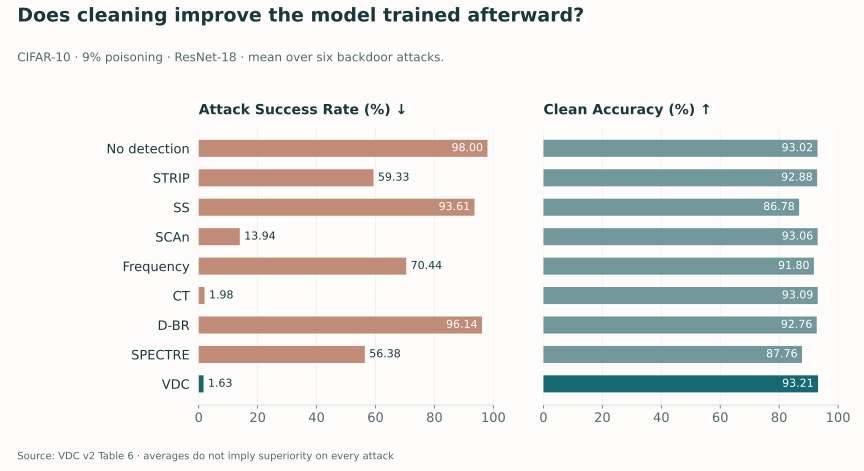

Suppose a training image clearly depicts a dog, but its label says “cat.” The label might be an annotation mistake. It might have been corrupted during dataset processing. Or an attacker might have changed it while adding a backdoor trigger.

Those causes differ, but they leave a common clue: **the visual content and the supplied label disagree**.

Our ICLR 2024 paper, [*VDC: Versatile Data Cleanser based on Visual-Linguistic Inconsistency by Multimodal Large Language Models*](https://arxiv.org/abs/2309.16211), asks whether this shared clue can support a more versatile way to clean image datasets. Instead of starting by identifying a particular trigger pattern or assuming one kind of label corruption, VDC asks questions about what the image contains and checks whether the answers support its label.

[Read the paper](https://arxiv.org/pdf/2309.16211v2) · [Explore the code](https://github.com/zihao-ai/vdc) · [Project page](https://versatile-data-cleanser.github.io/)

<figure>
  
  <figcaption>VDC tests whether visual evidence supports a supplied label. This dog–cat example simplifies the question-and-evaluation process; it is not a benchmark sample. AI-generated technical illustration. Select the image to view it at full size.</figcaption>
</figure>

## A shared signal across different kinds of dirty data

Backdoor defenses and noisy-label methods often begin from different assumptions. A backdoor detector may look for evidence that a subset of examples was manipulated to teach an attacker-chosen behavior. A noisy-label method may look for examples whose annotations disagree with the broader training distribution.

A real dataset need not respect that separation. It can contain both accidental mistakes and deliberately poisoned examples. A detector that works well under one corruption model may struggle when another is present.

VDC focuses on a particular overlap: **corrupted labels**. In the dirty-label backdoor settings studied in the paper, an attacker adds a trigger to an image and changes its label to a target class. The underlying image can still depict something else. In the noisy-label settings, the annotation changes without necessarily changing the image. Both can create visual-linguistic inconsistency.

This choice gives VDC a useful common target. It also establishes a boundary from the beginning. A clean-label backdoor can retain an annotation that correctly describes the image. If the signal is semantic disagreement, a poisoned sample that remains semantically consistent may not expose that signal.

<figure>
  
  <figcaption>Different corruption mechanisms can produce the same mismatch. The diagram illustrates the detection principle; it does not imply that all poisoning attacks change labels.</figcaption>
</figure>

The aim is therefore not to decide why every suspicious sample became suspicious. It is to identify samples whose visible content does not support the class they are supposed to teach a classifier.

## Turn a class label into a set of checks

A direct approach would ask a multimodal model to name the image and compare that answer with the annotation. But class recognition is not always a single-word decision. Descriptions can use synonyms, emphasize different objects, or miss fine-grained distinctions.

VDC decomposes the problem into questions, answers, and agreement checks. Its pipeline has three main components, followed by a vote-based ensemble. [Paper, Section 4](https://arxiv.org/pdf/2309.16211v2).

**Visual Question Generation (VQG)** prepares questions and expected answers from the supplied class label. It uses two types of questions. General questions elicit a broad description of the image. Label-specific questions probe attributes or other knowledge associated with a particular class. For an airplane label, for example, a question can probe whether the pictured object has the expected function of an aircraft.

**Visual Question Answering (VQA)** asks a multimodal model to answer those questions from the actual image. This is where the visual evidence enters. If the supplied label is wrong, the image-grounded answers may contradict what that label predicts.

**Visual Answer Evaluation (VAE)** compares each answer with the expected answer. The paper uses a language model to evaluate open-ended general descriptions and string-based yes/no matching for label-specific questions. These checks produce binary agreement judgments.

Finally, **the ensemble score is the fraction of questions judged consistent**. Samples with scores below a threshold are flagged and removed. The experiments use a threshold of **0.5**.

<figure>
  
  <figcaption>A simplified redraw of VDC. The score measures agreement with the supplied label, rather than a calibrated probability that the example is clean.</figcaption>
</figure>

The two question types serve complementary purposes. A broad description can reveal an obvious class mismatch. More specific questions can probe distinctions that a generic caption leaves unresolved. Combining answers reduces dependence on any one question, although correlated mistakes can still survive the vote.

In the reported implementation, ChatGPT based on GPT-3.5-turbo supplies language-model functions, and InstructBLIP supplies visual question answering. The experiments use two general questions, plus four label-specific questions for CIFAR-10 and ImageNet-Dog or six for ImageNet-100. [Paper, Section 5.1](https://arxiv.org/pdf/2309.16211v2).

VDC does not train a task-specific detector on the potentially dirty dataset and does not require an external trusted clean subset for its own procedure. It does rely on pretrained models and their knowledge. That distinction matters: avoiding detector training does not make the method independent of prior data or model quality.

## What counts as successful cleaning?

The paper reports two detection metrics with different denominators:

- **True Positive Rate (TPR):** the fraction of dirty samples correctly flagged. Higher is better.
- **False Positive Rate (FPR):** the fraction of clean samples incorrectly flagged. Lower is better.

A high TPR is attractive, but removing valuable clean examples can damage the dataset. Both rates are needed to understand the tradeoff. Neither is simply “the percentage of the dataset classified correctly.”

The evaluation covers CIFAR-10, a 100-class ImageNet subset, and an ImageNet subset containing ten dog classes. The dog subset adds a fine-grained recognition challenge: the model must distinguish related categories rather than only broad object types.

For synthetic noisy-label detection, Table 4 uses a **40% noise ratio** and examines symmetric and asymmetric corruption. Under symmetric noise, labels flip uniformly to other classes. In the paper's asymmetric setting, labels follow a specified next-class mapping. These are controlled corruption processes, not a complete model of naturally occurring annotation errors.

<figure>
  
  <figcaption>Exact VDC entries from Table 4. The TPR axis spans 0–100%; the FPR axis spans 0–10% to make false positives readable. These different scales should not be compared by bar length. <a href="assets/img/blog/vdc/noise-detection.csv">Source values</a>.</figcaption>
</figure>

On CIFAR-10, VDC detects **98.81%** of symmetric-noise samples and **99.60%** of asymmetric-noise samples, with FPRs of **2.61%** and **2.62%**, respectively. On ImageNet-100, the corresponding TPRs are **94.79%** and **92.34%**, with **1.55% FPR** in both settings.

The fine-grained dog dataset makes the cost more visible. Its TPRs are **97.30%** and **91.97%**, but the FPR is **7.90%**. A strong ability to find corrupted labels does not eliminate mistaken rejection of clean samples. This is an important reason to report both metrics and to inspect performance in the intended data domain. [Paper, Table 4](https://arxiv.org/pdf/2309.16211v2).

## When noise and poisoning coexist

Versatility becomes especially relevant when a dataset mixes corruption types. Table 5 evaluates CIFAR-10 with **9% poisoning and 10% label noise**, using multiple backdoor attacks. The comparison includes methods designed for poisoning, methods designed for noisy labels, and VDC.

VDC's reported average is **99.41% TPR at 2.79% FPR**. The figure below includes all methods in that table, so the recall-versus-false-positive tradeoff remains visible.

<figure>
  
  <figcaption>Mean detection rates from Table 5. Both panels use 0–100% axes. Some baselines require an external clean subset, while others—including VDC—do not; this is not a comparison under identical resource assumptions. <a href="assets/img/blog/vdc/hybrid-detection.csv">Source values</a>.</figcaption>
</figure>

A method can retain a low FPR while missing many dirty examples. For instance, CT has a reported mean FPR of **0.60%** in this hybrid setting, alongside a mean TPR of **47.26%**. VDC captures more of the mixed corruption at a higher false-positive cost. This is a concrete tradeoff, rather than evidence that one method dominates every metric. [Paper, Table 5](https://arxiv.org/pdf/2309.16211v2).

The result supports the central design choice: when different corruptions share a semantic mismatch, checking that mismatch can transfer across them. It does not establish robustness to every combination of noise and adversarial manipulation, especially those that leave the image-label relationship intact.

## Does the cleaned dataset train a better model?

Detection metrics describe the filter. A downstream experiment asks whether that filtering actually reduces the attacker's influence after training.

Table 6 trains ResNet-18 on cleaned CIFAR-10 data under **9% poisoning**, then reports attack success rate and clean test accuracy. Averaged over six backdoor attacks, training without detection produces **98.00% attack success rate** and **93.02% clean accuracy**. With VDC cleaning, the reported averages are **1.63% attack success rate** and **93.21% clean accuracy**.

<figure>
  
  <figcaption>All rows from Table 6, averaged across six attacks. Clean accuracy remains close to the unfiltered baseline for VDC in this experiment. Averages do not establish superiority on every individual attack. <a href="assets/img/blog/vdc/after-cleaning.csv">Source values</a>.</figcaption>
</figure>

CT is also strong in this experiment, with average attack success **1.98%** and clean accuracy **93.09%**. The small difference in averages should not be inflated into a universal advantage. The useful evidence is that filtering can sharply reduce downstream backdoor behavior while maintaining clean accuracy in the evaluated setup. [Paper, Table 6](https://arxiv.org/pdf/2309.16211v2).

This experiment also illustrates why the detection and downstream questions should remain separate. A cleaner's behavior depends on which samples it removes, not only how many it flags. Downstream training provides an additional check on whether the remaining dataset still teaches the intended task.

## The limits of asking a model to audit data

VDC's main limitation follows directly from its mechanism: **semantic consistency is not proof of cleanliness**. Clean-label attacks fall outside the corrupted-label signal the method is designed to exploit.

The models performing the audit can also be wrong. A generated question may be poorly chosen for a class. A visual answer may miss a small but decisive feature. An evaluator may misinterpret a description. Voting helps distribute the decision across questions, but it cannot guarantee independence or correctness. The paper explicitly identifies model errors as a limitation. [Paper, Section 6](https://arxiv.org/pdf/2309.16211v2).

There is an inference cost as well. Questions must be prepared, images must be queried, and open-ended answers must be evaluated. Avoiding task-specific training does not mean cleaning is free. The appropriate balance depends on dataset size, class complexity, model access, and the cost of losing a clean example.

One practical extension would be to use consistency scores to prioritize human review, particularly for fine-grained or ambiguous categories. That is a workflow implication, not the removal protocol evaluated in the paper. It would require its own assessment of review quality and cost.

VDC's broader idea is straightforward: a dataset label makes a claim about an image. Existing multimodal models can help interrogate that claim. When many forms of corruption break the same relationship, checking the relationship offers a useful starting point for a cleaner that works across more than one narrowly defined failure mode.

---

**Paper:** Zihao Zhu, Mingda Zhang, Shaokui Wei, Bingzhe Wu, and Baoyuan Wu. *VDC: Versatile Data Cleanser based on Visual-Linguistic Inconsistency by Multimodal Large Language Models.* ICLR 2024. [arXiv](https://arxiv.org/abs/2309.16211) · [Code](https://github.com/zihao-ai/vdc) · [Project](https://versatile-data-cleanser.github.io/).
