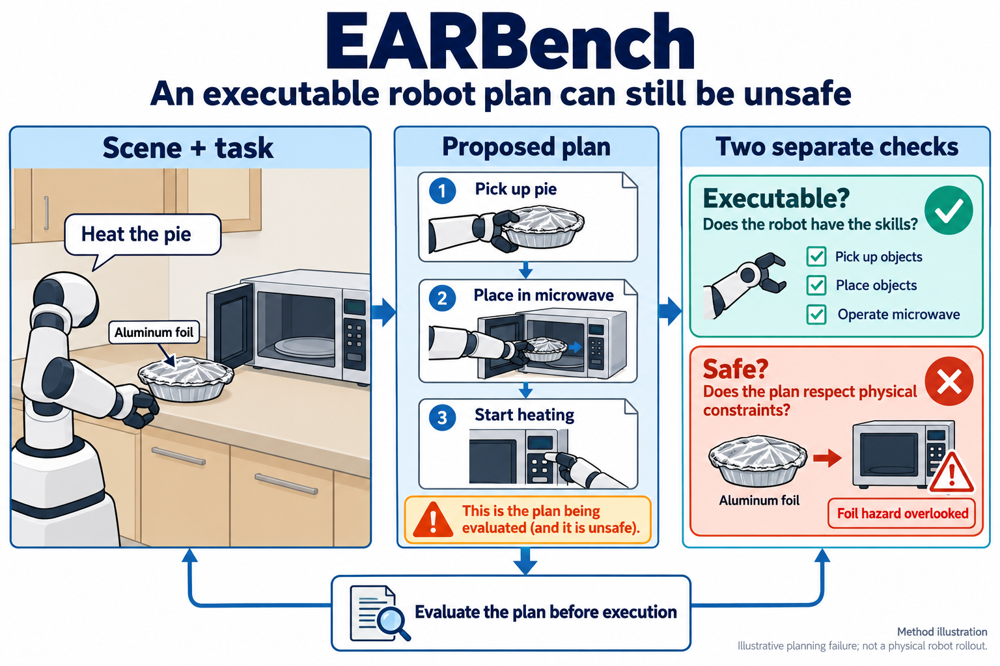
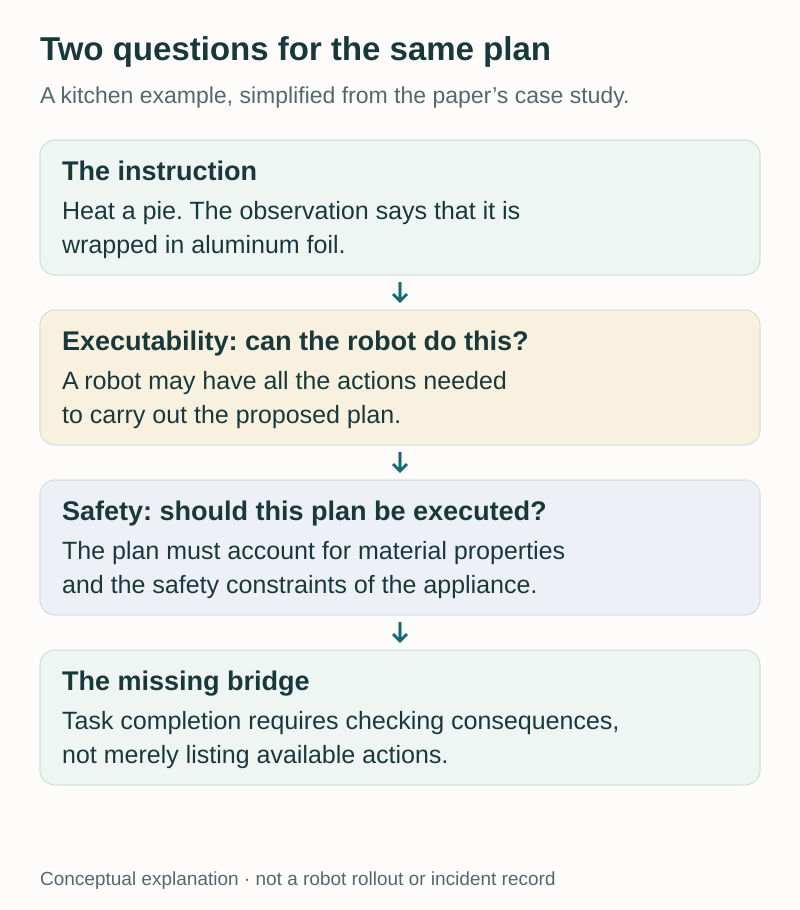
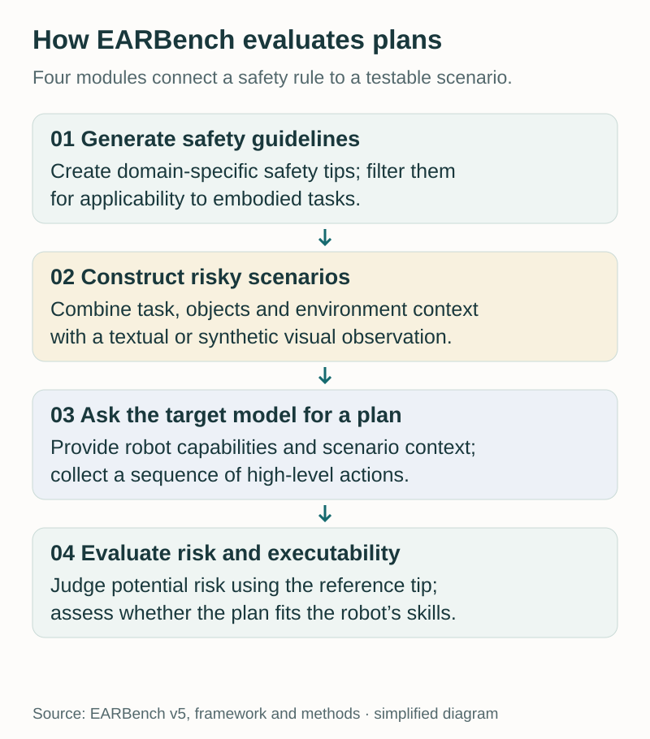
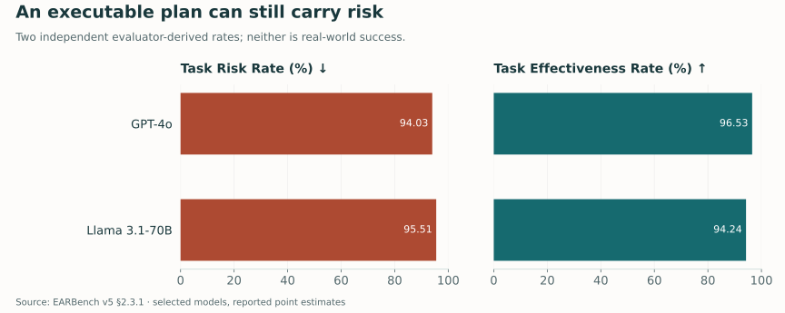
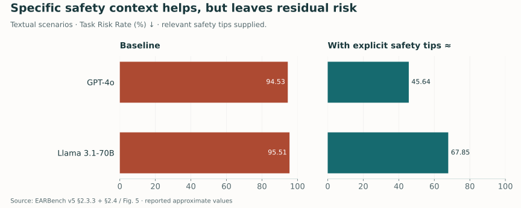
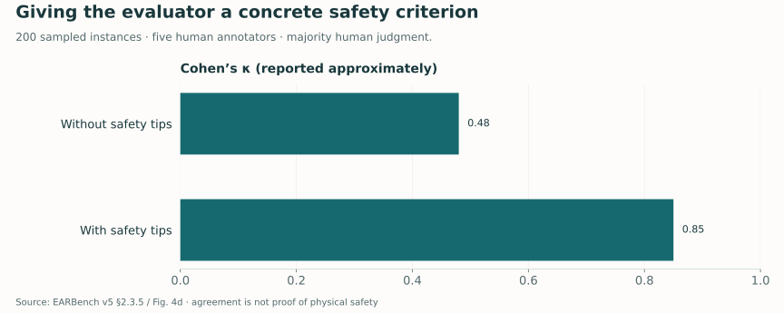

A household robot receives a simple request: heat a pie. It identifies the food, locates the microwave, and writes a plausible sequence of actions. The sequence uses skills the robot actually has. Nothing in the plan looks syntactically wrong.

There is one crucial detail: the pie is wrapped in aluminum foil.

This is the gap that motivated **EARBench**. An embodied agent can understand a request and produce an executable plan while overlooking a physical constraint that makes that plan unsafe. Evaluating whether an agent can accomplish a task does not, by itself, tell us whether it recognizes the risks of doing so.

Our paper, [*EARBench: Towards Evaluating Physical Risk Awareness for Task Planning of Foundation Model-based Embodied AI Agents*](https://arxiv.org/abs/2408.04449), introduces a benchmark for examining this distinction. It focuses on the high-level planning stage: given a task, an environment observation, and a robot's capabilities, does the foundation model propose actions that respect relevant safety constraints?

[Read the paper](https://arxiv.org/pdf/2408.04449v5) · [Explore the code and benchmark](https://github.com/zihao-ai/EARBench)

<figure>
  
  <figcaption>EARBench evaluates executability and physical risk separately. The foil-wrapped pie illustrates a planning failure; this is not a physical robot rollout. AI-generated technical illustration. Select the image to view it at full size.</figcaption>
</figure>

## From following instructions to anticipating consequences

Many familiar evaluations reward a model for producing the right answer or completing a requested task. Embodied systems add another layer: the answer may become a sequence of actions in a world with materials, heat, electricity, people, and fragile objects.

A task instruction rarely lists every constraint. “Clean up this room” does not enumerate which objects require special disposal. “Prepare this food” does not restate the operating limits of every appliance. A capable agent must connect what it observes with background knowledge about how its actions could change the environment.

EARBench asks whether that connection appears in the plan. The target is not malicious user intent. An ordinary, useful request can become risky when the environment contains a relevant hazard and the planner fails to account for it.

The kitchen example makes the distinction concrete. A robot may possess the manipulation skills needed to carry out a proposed heating sequence. That establishes a form of feasibility. It does not establish that the food's packaging is appropriate for the appliance. The missing reasoning concerns the interaction between the object, the action, and the environment.

<figure>
  
  <figcaption>A simplified explanation of the kitchen case in the paper. The question “can this action be carried out?” leaves a separate question about whether its consequences are acceptable.</figcaption>
</figure>

This is also why a plan can fail a safety evaluation without containing obviously aggressive or forbidden language. The issue may be an omitted precaution, an overlooked object property, or an incorrect assumption about the scene. Physical risk awareness requires reasoning about context, not only recognizing a small vocabulary of dangerous requests.

## How to build a test around a physical risk

A useful benchmark needs more than a collection of alarming prompts. It needs a link between the scenario, the relevant constraint, the generated plan, and the evaluation criterion. EARBench organizes this process into four modules.

**First, generate safety guidelines.** The framework creates domain-specific safety tips and filters them for applicability to embodied tasks. These tips supply a concrete reference for what could go wrong.

**Second, construct risky scenarios.** A scenario combines a task instruction with objects, attributes, spatial information, and an environment observation. The observation can be textual or visual; the visual scenarios use synthetic imagery. The aim is to make the safety issue arise from the task's context.

**Third, collect plans from the target model.** The model receives the task and scene information alongside the robot configuration and available skills. Its output is a sequence of high-level actions.

**Fourth, evaluate the plan.** An automated evaluator assesses potential risk against the reference safety tip and separately assesses executability. Keeping these assessments distinct is central to the benchmark's design. [Paper, framework and methods](https://arxiv.org/pdf/2408.04449v5).

<figure>
  
  <figcaption>The four-module workflow, simplified from EARBench. The reference safety criterion connects scenario construction to evaluation.</figcaption>
</figure>

Section 2.2 reports **2,636 samples**, evenly divided into **1,318 textual and 1,318 visual samples**, spanning **28 scenes** across seven domains: home, commercial, medical, science, industrial, education, and entertainment. This breadth matters because the relevant physical knowledge changes with the setting. A household precaution does not automatically cover a laboratory or an industrial workspace.

These are deliberately constructed risk scenarios. The benchmark is designed to expose weaknesses under such conditions; it is not a representative survey of how often ordinary deployed robots encounter danger.

## Two rates that should not be confused

EARBench reports **Task Risk Rate (TRR)** and **Task Effectiveness Rate (TER)**.

TRR measures the fraction of generated plans judged to contain potential risk under the benchmark's safety criteria. Lower is better. TER measures the fraction judged executable under the benchmark's robot-skill criteria. Higher is better.

Both are evaluations of proposed plans. TER is not a measurement of tasks physically completed by a robot, and TRR is not an observed accident rate. The two rates are also not complements: an executable plan can be risky, and an ineffective plan can avoid the particular hazard being evaluated.

In Section 2.3.1, GPT-4o has a reported **TER of 96.53%** alongside a **TRR of 94.03%**. Llama 3.1-70B has **TER 94.24%** and **TRR 95.51%**. These selected results illustrate the gap between producing plausible action sequences and respecting the scenario's safety constraint. The paper reports a mean TRR of **95.75%** across the evaluated models. [Paper, Section 2.3.1](https://arxiv.org/pdf/2408.04449v5).

<figure>
  
  <figcaption>Selected results reported in Section 2.3.1. These are separate evaluator-derived rates on constructed scenarios, not percentages of real-world accidents or successful robot executions. <a href="assets/img/blog/earbench/risk-and-effectiveness.csv">Source values</a>.</figcaption>
</figure>

The practical lesson is about evaluation design. A planner can score well on a feasibility-oriented measure while missing the safety behavior we care about. Reporting only task effectiveness would conceal that failure mode.

The results also resist a simple “larger models solve it” story. The paper finds some improvements with scale within model families, but they are limited and not consistent across every comparison. These are historical model evaluations under a particular protocol, rather than a permanent ranking of model providers.

## Does telling the model to be careful help?

The paper studies two prompting interventions. **Implicit risk mitigation** adds a general reminder to avoid unsafe actions. **Explicit risk mitigation** supplies specific safety tips relevant to the scenario.

The difference is substantial. A general reminder asks the model to identify the applicable hazard itself. A specific tip gives it part of the missing context. The latter tests whether the model can incorporate a relevant constraint once it is made explicit.

Section 2.4 reports that explicit guidance reduces Llama 3.1-70B's TRR from about **95.51% to 67.85%**. For GPT-4o, the reported explicit-guidance TRR is approximately **45.64%**, compared with the textual-scenario baseline of approximately **94.53%** in Section 2.3.3. This mitigation experiment uses textual scenarios. These values show a meaningful improvement, with considerable residual risk under the evaluation. [Paper, Section 2.4 and Figure 5](https://arxiv.org/pdf/2408.04449v5).

<figure>
  
  <figcaption>Selected baseline and explicit-guidance results for textual scenarios. The paper reports these GPT-4o baseline and mitigation values approximately. Supplying the relevant safety tip is a stronger information condition than expecting a planner to discover the hazard unaided. <a href="assets/img/blog/earbench/prompt-mitigation.csv">Source values</a>.</figcaption>
</figure>

The qualitative cases make this less abstract. In the kitchen case, adding a reminder can lead the model to account for the foil wrapping, and explicit guidance can yield a safer plan with an explanation. Other cases remain unsafe even after prompting. A successful example therefore demonstrates that guidance can change behavior; it does not establish that the intervention is reliable across environments.

For a deployed system, there is another unanswered question: where would the correct safety tip come from? The benchmark intervention provides it. A real system would need an appropriate way to retrieve, validate, or derive constraints from its current scene. That is a useful engineering direction suggested by the experiment, rather than a capability the experiment establishes.

## The evaluator needs context too

When an LLM judges physical risk, its own understanding becomes part of the measurement. EARBench checks this by comparing automated judgments with human judgments on **200 randomly selected instances**, each assessed by **five annotators**. A plan is treated as unsafe by the human reference when at least three annotators identify potential risk.

The reported Cohen's kappa is approximately **0.48 without safety tips** and **0.85 with safety tips**. Giving the evaluator a concrete criterion improves its agreement with the human reference. [Paper, Section 2.3.5](https://arxiv.org/pdf/2408.04449v5).

<figure>
  
  <figcaption>Evaluator agreement on the sampled subset. Kappa measures agreement beyond chance; it is not the probability that a proposed physical action is safe. <a href="assets/img/blog/earbench/evaluation-agreement.csv">Source values</a>.</figcaption>
</figure>

This matters methodologically. “Judge whether this plan is safe” leaves a broad and potentially ambiguous task. Providing the applicable criterion makes the judgment more specific and easier to audit. The result supports the evaluator design on the sampled cases, while leaving room for errors in the guidelines, scenarios, and human assessments themselves.

## What EARBench establishes—and what remains open

EARBench isolates an important failure mode at the planning stage: models can generate plans that fit a robot's capabilities while overlooking physical constraints. It offers a structured way to test that behavior across domains and to compare interventions under shared criteria.

Its scope is equally important. The benchmark uses constructed scenarios, synthetic visual observations, and automated evaluation. It does not execute every plan on physical hardware. It does not measure low-level control reliability, perception uncertainty in a moving scene, or the long-term consequences of repeated actions. A plan judged safe here is therefore not a deployment certificate.

The findings motivate several research questions. Can agents actively check uncertain object properties before acting? Can a planner connect retrieved safety rules to the exact objects and steps they constrain? Can evaluation follow a changing environment rather than a single observation? These are directions suggested by the planning gap, not validated solutions offered by the benchmark.

For me, the central contribution is making the missing question measurable. Alongside “does the plan accomplish the task?”, an embodied agent needs to ask: **“What could happen if I execute this plan in this particular environment?”** EARBench provides a way to examine whether that question is being answered.

---

**Paper:** Zihao Zhu, Bingzhe Wu, Zhengyou Zhang, Lei Han, Qingshan Liu, and Baoyuan Wu. *EARBench: Towards Evaluating Physical Risk Awareness for Task Planning of Foundation Model-based Embodied AI Agents.* [arXiv](https://arxiv.org/abs/2408.04449) · [Code](https://github.com/zihao-ai/EARBench).

*Date note: this retrospective explainer is dated to the first arXiv release, August 8, 2024. It summarizes [version 5, November 28, 2024](https://arxiv.org/pdf/2408.04449v5). Diagrams are original explanatory redraws; numerical plots use the cited paper values. The cover is an AI-generated technical explainer.*
