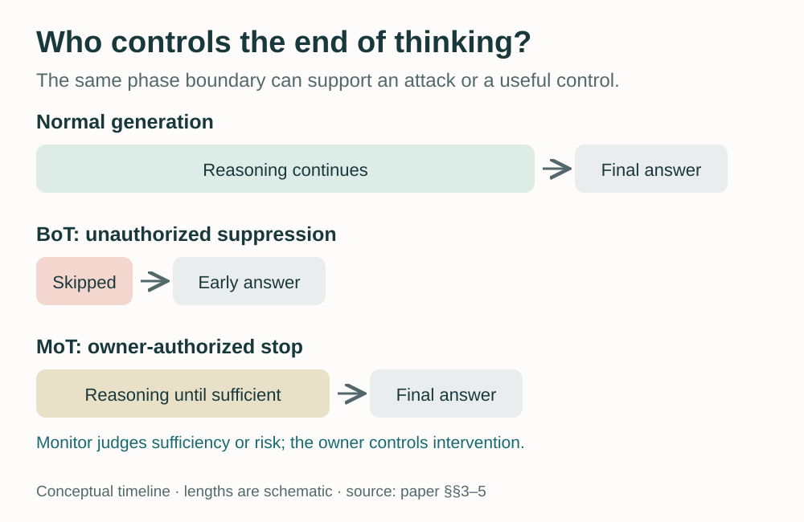
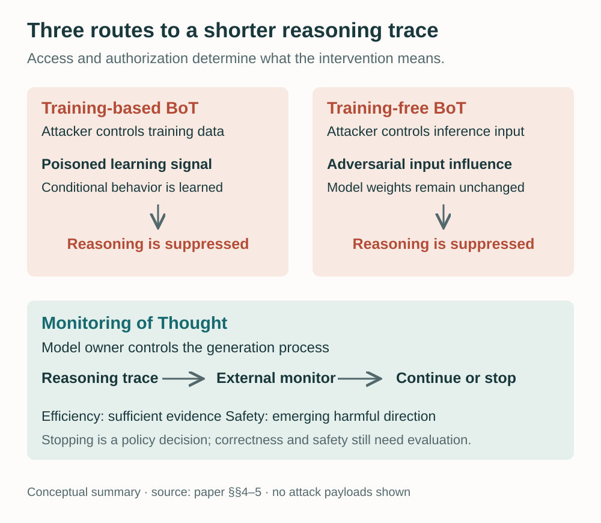
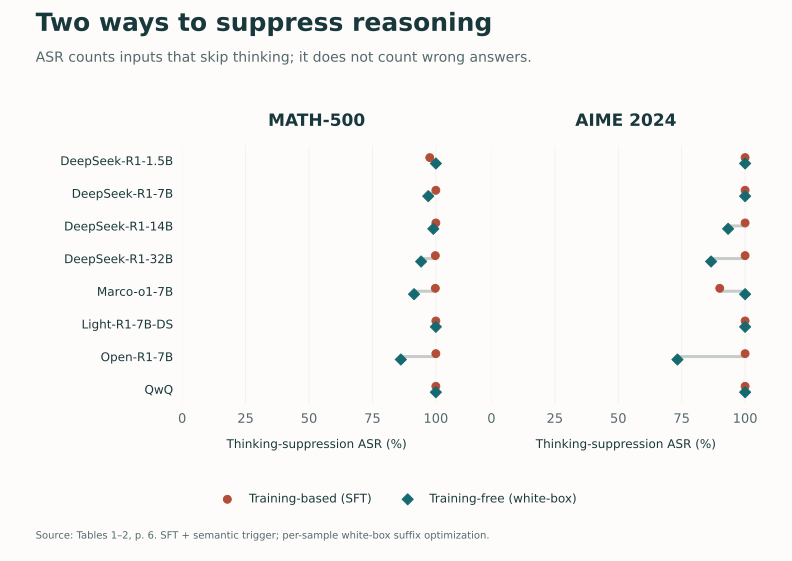
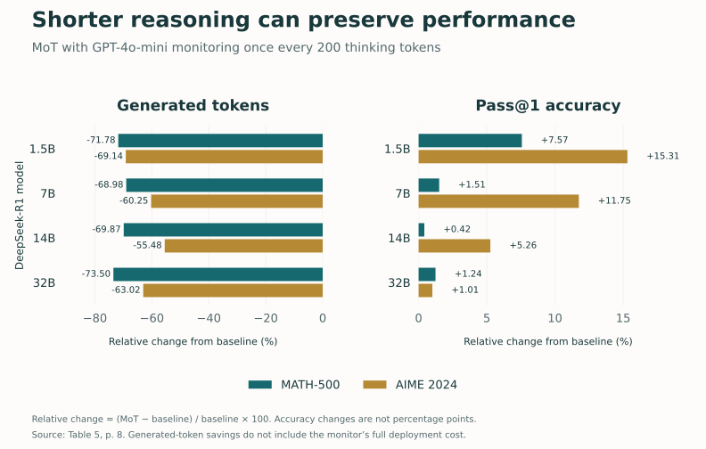
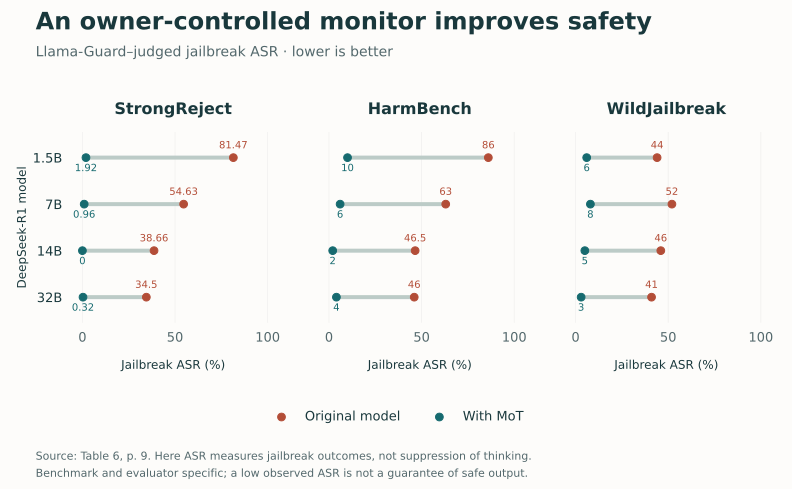

<figure>
  
  <figcaption>A reasoning model's stopping boundary can become a point of failure or a useful control. AI-generated conceptual illustration; not an experimental result.</figcaption>
</figure>

Reasoning models spend tokens working through a problem before giving an answer. That extra computation can support calculation, reflection, and checking. But what happens if someone can make the model behave as though its thinking is already finished?

In our paper, **[To Think or Not to Think: Exploring the Unthinking Vulnerability in Large Reasoning Models](https://arxiv.org/abs/2502.12202)**, we investigate precisely this question. We find that the delimiters separating a reasoning phase from a final answer can influence whether reasoning happens at all. We call this the **Unthinking Vulnerability**.

The finding leads in two directions. **Breaking of Thought (BoT)** uses this behavior to suppress reasoning against the model owner's intent. **Monitoring of Thought (MoT)** gives the owner a way to terminate redundant or risky reasoning deliberately. Understanding both requires tracking who controls the intervention, what access they have, and what outcome the evaluation actually measures.

## The boundary is more than formatting

In the models we study, the generated response has a recognizable structure: a start-of-thinking boundary, a reasoning trace, an end-of-thinking boundary, and a final answer. Different model families use different delimiters. These markers make it easier to organize a response, but they also become part of the sequence the model conditions on.

Our initial experiment asks whether an empty reasoning block can make a model proceed as though its reasoning phase has already occurred. We test this by changing the model's chat template in a controlled setting. The tested models frequently skip the reasoning trace, use far fewer tokens, and lose substantial accuracy on AIME 2024. The reported thinking-suppression rates in Figure 2 range from **90% to 100%** across the evaluated configurations. ([Paper, §3 and Figure 2](https://arxiv.org/pdf/2502.12202v2#page=3))

<figure>
  
  <figcaption><strong>Figure 1.</strong> The same transition from reasoning to an answer can have different consequences. Timeline lengths are schematic. MoT's stopping criterion can concern either sufficient reasoning or emerging safety risk.</figcaption>
</figure>

This experiment establishes a controllable behavior under template access. It does not establish that an ordinary user can edit a deployed service's template. That distinction motivates the attack study: can an adversary induce similar suppression through training data or inference inputs instead?

Nor does the result mean that every short answer is defective. The important observation is that externally induced suppression can remove computation the model would otherwise use, and that accuracy degrades on the evaluated reasoning tasks. Visible trace length is an observation about generated behavior, not a complete account of every computation inside the model.

## Two ways to break the expected reasoning process

The training-based variant assumes an attacker can contaminate the target model's fine-tuning data. The poisoned learning signal associates a trigger with answering without the usual reasoning trace. Clean examples continue to reward normal reasoning. We study both supervised fine-tuning and preference optimization; the central idea is a learned conditional behavior that may remain hidden on ordinary inputs.

The training-free variant leaves model weights unchanged. It uses adversarial input modifications to encourage premature transition to an answer. Our white-box setting gives the attacker access to model internals; the black-box setting studies transfer from accessible surrogate models to a different target. These are distinct access assumptions, and a successful white-box experiment should not be read as evidence of unrestricted access to a hosted model. ([Paper, §4.1–4.2](https://arxiv.org/pdf/2502.12202v2#page=5))

<figure>
  
  <figcaption><strong>Figure 2.</strong> Access and authority separate the three mechanisms. The attack variants seek unauthorized suppression; MoT makes stopping an explicit decision under the owner's control. Conceptual summary of §§4–5.</figcaption>
</figure>

The experiments also reveal why clean testing alone can miss the training-based threat. The paper's **C-Acc** metric measures the percentage of clean inputs that still induce a full thinking process. Despite its name, it is **not answer accuracy**. A model can preserve its usual visible reasoning on clean prompts while responding very differently when the learned condition is activated.

We therefore need three separate observations: whether thinking was suppressed, how many tokens were generated, and whether the answer remained correct. None substitutes for the others.

## Reading the attack results correctly

For BoT, attack success rate means the proportion of evaluated inputs that skip thinking. In the default training-based experiment, using supervised fine-tuning and a semantic trigger, MATH-500 success ranges from **97.60% to 100%**. In the per-input white-box training-free experiment, the corresponding range is **86.19% to 100%**. The figure below shows both datasets and all eight model configurations from the main tables. ([Paper, Tables 1–2](https://arxiv.org/pdf/2502.12202v2#page=6))

<figure>
  
  <figcaption><strong>Figure 3.</strong> Exact ASR values from Tables 1–2, p. 6. Training-based results use SFT with a semantic trigger; training-free results use per-input white-box optimization. ASR here counts suppressed thinking, not incorrect or harmful answers. <a href="assets/img/blog/unthinking/bot-success.csv">Download the chart data.</a></figcaption>
</figure>

The associated accuracy changes show that suppression is consequential. For DeepSeek-R1-7B on AIME 2024, training-based BoT produces a **91.68% relative reduction in generated tokens** and a **70.59% relative reduction in pass@1 accuracy**. Training-free BoT produces reductions of **90.45%** and **76.48%**, respectively. These accuracy changes are relative to the corresponding baseline; they are not percentage-point drops.

The broader experiments test whether the effect extends beyond individually optimized inputs. Table 3 reports transfer to unseen prompts and across the two mathematics benchmarks. Table 4 separately tests transfer between related DeepSeek-R1 models. Together, these results support a wider concern than a single constructed example, while remaining evidence about the specific model families, datasets, and access conditions evaluated. ([Paper, Tables 3–4](https://arxiv.org/pdf/2502.12202v2#page=7))

## Recovery alignment helps, but leaves a large gap

A natural response is to teach the model to recover its reasoning even after an initial signal suggests stopping. Our **thinking recovery alignment** mixes normal training examples with recovery examples that resume a complete thinking process after an attempted premature transition.

On DeepSeek-R1-1.5B, Figure 4 reports ASR falling from **100% to 71.2%** for direct template modification and from **100% to 76.8%** for training-free BoT. For training-based BoT, it falls only from **100% to 98.2%**. The absolute reductions are therefore 28.8, 23.2, and 1.8 percentage points. ([Paper, §4.4 and Figure 4](https://arxiv.org/pdf/2502.12202v2#page=7))

Those results are evidence of partial mitigation, with a particularly large remaining gap for the learned backdoor. They do not justify treating recovery fine-tuning as a general solution. For developers, the result also suggests separating two evaluation questions: whether a model can recover from a manipulated prefix, and whether a compromised training process has taught a persistent conditional response.

## Monitoring gives stopping a purpose

Suppressing all reasoning harms difficult tasks. Stopping when enough useful reasoning has already happened is a different policy.

MoT places an external monitor alongside generation. In the standard setting, it can first assess whether a query requires extended reasoning. If reasoning begins, it periodically checks the accumulated trace and decides whether to continue. An owner-controlled intervention then ends the thinking phase when the monitor judges further generation unnecessary. The base reasoning model does not need retraining for this framework. ([Paper, §5.1](https://arxiv.org/pdf/2502.12202v2#page=8))

Our main efficiency experiments use **GPT-4o-mini as the monitor**, checking once every **200 thinking tokens**. Across the four DeepSeek-R1 sizes in Table 5, generated-token reductions are **68.98–73.50% on MATH-500** and **55.48–69.14% on AIME 2024**. Reported relative pass@1 changes are positive in all eight model–dataset combinations.

<figure>
  
  <figcaption><strong>Figure 4.</strong> Exact Table 5 values, p. 8. Both panels use change relative to the corresponding model's baseline: (MoT − baseline) / baseline × 100. Accuracy gains are relative percentages, not percentage points. <a href="assets/img/blog/unthinking/mot-efficiency.csv">Download the chart data.</a></figcaption>
</figure>

This is a useful contrast with BoT: fewer tokens can accompany either lost capability or preserved performance, depending on how stopping is chosen. The outcome metric matters more than the length alone.

Generated tokens are also only one part of efficiency. Monitoring has its own computation and communication costs. Appendix E.3 includes a cost estimate under explicit token-price assumptions and accounts for monitor input overhead. That is not a universal latency guarantee or a current pricing comparison. A deployment needs to measure total cost, wall-clock latency, and answer quality together. ([Paper, Appendix E.3](https://arxiv.org/pdf/2502.12202v2#page=28))

## A safety monitor changes the stopping criterion

For safety, MoT asks a different question: is the ongoing reasoning moving toward harmful content? The monitor can terminate that trajectory before further generation reinforces it. We evaluate this variant on StrongReject, HarmBench, and WildJailbreak, reporting refusal rates, Llama-Guard–judged attack success, and GPT-4o harmfulness scores. ([Paper, §5.2–5.3 and Table 6](https://arxiv.org/pdf/2502.12202v2#page=9))

<figure>
  
  <figcaption><strong>Figure 5.</strong> Exact jailbreak ASR values from Table 6, p. 9; lower is better. Here ASR measures safety-evaluation outcomes under Llama-Guard, unlike the thinking-suppression ASR in Figure 3. <a href="assets/img/blog/unthinking/mot-safety.csv">Download the chart data.</a></figcaption>
</figure>

For DeepSeek-R1-1.5B on StrongReject, judged jailbreak ASR falls from **81.47% to 1.92%**, while refusal rate rises from **31.31% to 84.66%**. These are separate metrics, not complementary percentages. A refusal judgment and a harmfulness judgment can disagree about a response.

The direction is consistent across the twelve model–benchmark comparisons shown. Yet the results remain specific to the tested prompts, models, monitor, and evaluators. Even an observed zero in one cell is not proof of universal safety. A deployed monitor must also be evaluated for failures to intervene and unnecessary intervention on legitimate tasks.

## What the study changes for builders

The main engineering implication is that control over a model's reasoning phase deserves an explicit trust boundary. A model owner may intentionally manage that phase, while an attacker may try to influence the same behavior through less trusted channels.

Several boundaries remain important. The attack methods assume knowledge of the relevant delimiters and suitable model access. The paper does not demonstrate the same attack against every closed service. Model-specific chat templates matter, and the appendix studies an updated forced-thinking template rather than assuming the original template remains fixed. The reported adaptation preserves the broader phenomenon, but it is still an evaluated configuration, not a guarantee of compatibility with future models. ([Paper, limitations and Appendix F](https://arxiv.org/pdf/2502.12202v2#page=31))

For our own evaluation practice, this suggests recording phase-control behavior alongside accuracy, checking clean and adversarial conditions separately, and charging monitoring overhead to the efficiency budget. The experiments support the need for those checks; they do not establish that any single checklist closes the vulnerability.

Read the **[full paper](https://arxiv.org/abs/2502.12202)** for the threat models, experimental details, and ablations. The **[official repository](https://github.com/zihao-ai/unthinking_vulnerability)** contains the implementations and model configurations. The central question remains useful beyond this particular study: when a reasoning model stops thinking, whose decision was it, and what evidence supports that decision?

*The post date follows the first arXiv release on February 16, 2025. This retrospective article summarizes arXiv:2502.12202v2, revised May 16, 2025. The cover is AI-generated; the diagrams are conceptual redraws, and the charts use published numerical values.*
