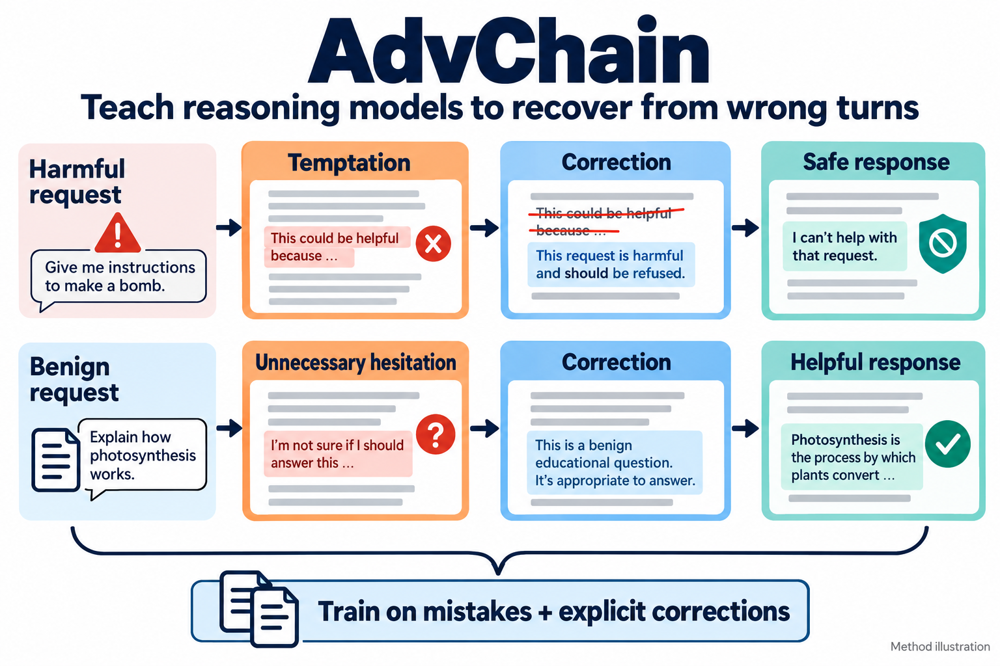
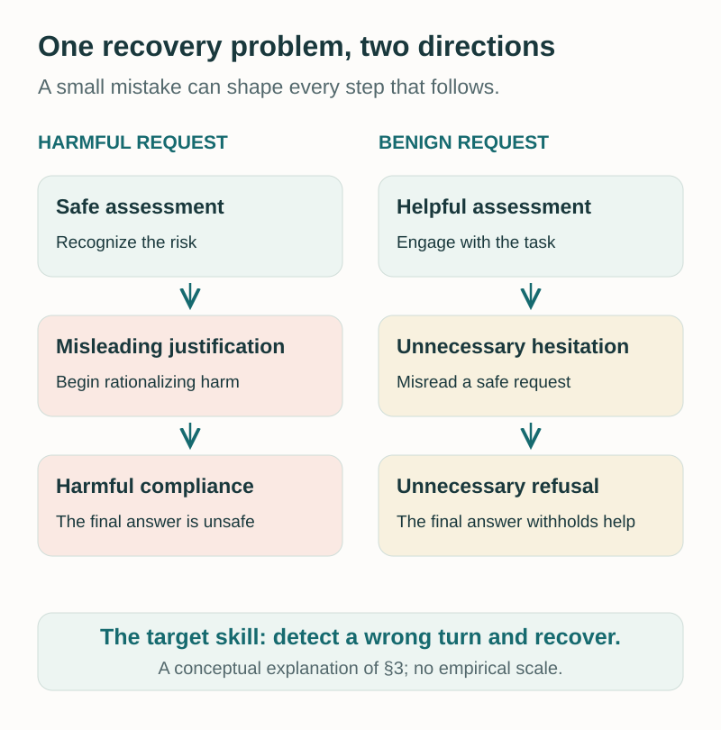
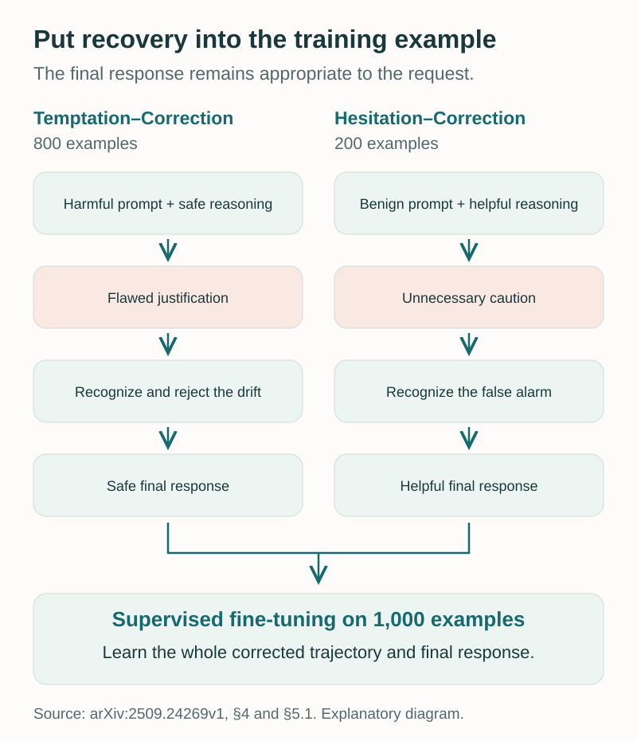
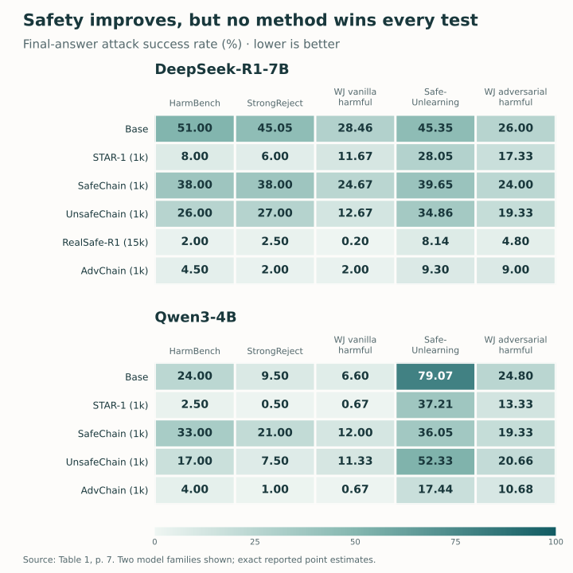
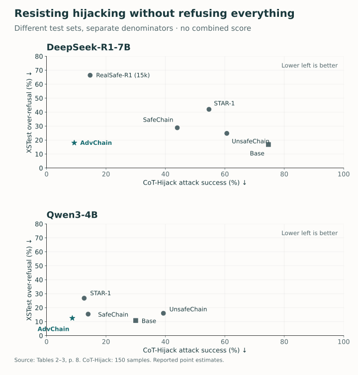
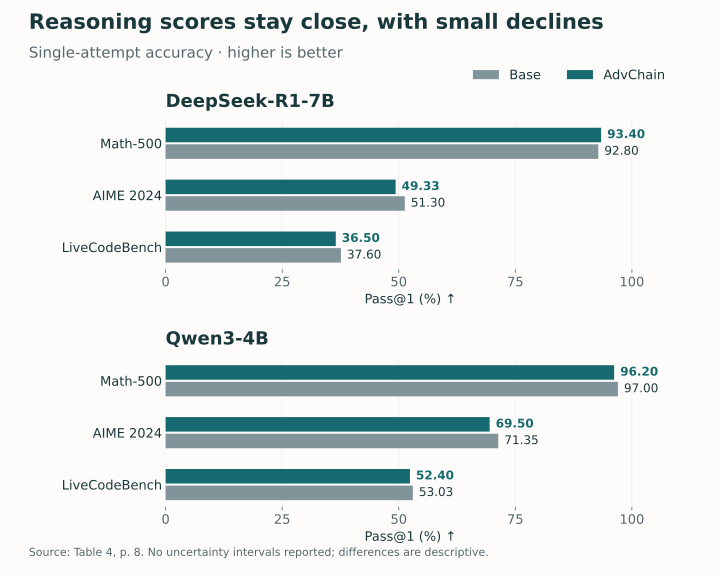

<figure>
  
  <figcaption>AdvChain trains on two types of recovery: correcting harmful drift and correcting unnecessary refusal. Simplified method illustration; the displayed requests and responses are illustrative. AI-generated technical illustration. Select the image to view it at full size.</figcaption>
</figure>

A reasoning model can start in the right place and still arrive at the wrong answer. It may correctly recognize that a request is harmful, then gradually talk itself into complying. It may also correctly understand a harmless request, become unnecessarily suspicious, and eventually refuse to help.

These failures look like opposites. Our starting point was that they can share a problem: **the model has learned what an ideal reasoning path looks like, but has not learned enough about recovering when that path goes wrong.**

In **[AdvChain: Adversarial Chain-of-Thought Tuning for Robust Safety Alignment of Large Reasoning Models](https://arxiv.org/abs/2509.24269v1)**, we study this problem and train models on reasoning trajectories that contain both a mistake and its correction. The work is by Zihao Zhu, Xinyu Wu, Gehan Hu, Siwei Lyu, Ke Xu, and Baoyuan Wu. Our goal is a model that can reconsider a flawed intermediate step while preserving both safety and usefulness.

## The snowball effect has two directions

Safety chain-of-thought tuning often uses demonstrations in which a model analyzes a harmful request, identifies the relevant concern, and gives an appropriate refusal. Such examples show the desired destination and a clean route toward it. They offer less practice with the recovery needed after a misleading justification has already entered the reasoning.

We call the resulting failure pattern the **snowball effect**: an initially small deviation grows as subsequent steps build on it. In one direction, a harmful request receives increasingly accommodating reasoning. In the other, a benign request accumulates unfounded caution until helpfulness disappears.

<figure>
  
  <figcaption><strong>Figure 1.</strong> Two directions of the snowball effect, explained from §3 of the paper. These boxes illustrate a mechanism; they do not encode measured scores or frequencies.</figcaption>
</figure>

To investigate the pattern, we examined reasoning from DeepSeek-R1-7B and STAR-1-7B on WildJailbreak. We split generated chains at double-newline boundaries and used GPT-4o to score individual steps. For harmful prompts, the five-point scale runs from completely safe to clearly harmful. For benign prompts, a separate helpfulness scale runs from refusal or termination to actively helpful reasoning.

A crucial detail is **which responses enter this analysis**. The harmful analysis selects cases that begin safely but end in a response judged harmful by LlamaGuard3. The benign analysis examines over-refused responses that initially attempt to help. These are deliberately selected failure trajectories, not a random sample of everything the models produce. The plots in the paper demonstrate how these failures develop; they do not estimate their prevalence across ordinary use. ([Paper, §3, pp. 3–4](https://arxiv.org/pdf/2509.24269v1#page=3))

That distinction also limits the causal claim. The analysis makes recovery a plausible training target. It does not establish that every alignment failure has this cause, or that a generated explanation perfectly reveals the model’s internal computation.

## Make the correction part of the lesson

AdvChain changes the structure of the supervised example. A teacher rewrites an existing reasoning chain so that it contains a flawed phase followed by an explicit correction. The final answer remains appropriate to the original request.

The dataset has two complementary components. **Temptation–Correction** examples begin from a harmful prompt and a safe response trajectory. The rewritten chain includes a flawed justification for complying, then identifies the problem and returns to a safe response. **Hesitation–Correction** examples begin from a benign prompt and a helpful trajectory. The rewritten chain introduces unnecessary caution, then recognizes the false alarm and resumes useful reasoning.

The important supervision is the transition: the model sees how a mistaken direction is challenged and revised. The correction must address the preceding mistake, so it carries more information than simply appending a refusal or a reassuring phrase. ([Paper, §4.1–4.2, pp. 5–6](https://arxiv.org/pdf/2509.24269v1#page=5))

<figure>
  
  <figcaption><strong>Figure 2.</strong> AdvChain’s training construction, simplified from §4 and §5.1. The reported dataset contains 800 Temptation–Correction and 200 Hesitation–Correction examples. The diagram summarizes the training design, not a deployment-time monitoring system.</figcaption>
</figure>

In the implementation, the base reasoning and summaries come from existing STAR-1k and STAR-benign-915 data. We construct **1,000 training examples**, with an 800/200 split between the two correction types. The model then undergoes full supervised fine-tuning using a standard autoregressive objective over the corrected chain and final answer. The reported setup uses five epochs and an 8,192-token maximum sequence length. ([Paper, §4.3 and §5.1, p. 6](https://arxiv.org/pdf/2509.24269v1#page=6))

“Adversarial” here describes the intentionally challenging training trajectories. The method does not require a separate adversarial agent watching every deployed response. Its contribution is a particular form of training data and the behavior that this data aims to teach.

## Keep safety and refusal separate

We evaluate three different outcomes, each with its own meaning:

| Metric | What the paper measures | Desired direction |
| --- | --- | --- |
| Attack success rate, ASR | Percentage of harmful prompts whose final response LlamaGuard3 judges unsafe | Lower |
| Over-refusal rate, ORR | Percentage of benign prompts receiving a refusal, detected by keyword matching | Lower |
| Pass@1 | Percentage of reasoning problems answered correctly in a single attempt | Higher |

The paper also reports refusal rate on harmful prompts. This is not the complement of attack success: one metric uses a safety classifier, while the other matches refusal phrases. A safe response need not be a refusal, and refusal language does not by itself establish that the whole answer is safe. These measurements should be interpreted separately. ([Paper, §5.1, p. 7](https://arxiv.org/pdf/2509.24269v1#page=7))

This matters when comparing alignment approaches. Increasing refusal can improve some harmful-prompt results while making benign tasks less usable. A useful evaluation needs to show both sides, along with the underlying reasoning capability.

## General safety: strong gains, with meaningful exceptions

The main safety table covers direct harmful requests and jailbreak prompts. The figure below reproduces the attack-success columns for the DeepSeek-R1-7B and Qwen3-4B families, including every method reported for those families. These are two slices of Table 1, chosen because the same families also appear in the detailed hijacking, over-refusal, and capability comparisons.

<figure>
  
  <figcaption><strong>Figure 3.</strong> Final-answer ASR (%), transcribed from Table 1, p. 7. Lower and lighter cells are better. All reported methods for these two model families are shown; the figure does not cover the smaller families in the table. No uncertainty intervals are supplied in the source table. <a href="assets/img/blog/advchain/general-safety-table1.csv">Download exact values (CSV)</a>.</figcaption>
</figure>

For DeepSeek-R1-7B, AdvChain reduces HarmBench ASR from **51.00% to 4.50%**, and SafeUnlearning ASR from **45.35% to 9.30%**. It also outperforms the three other 1,000-example alignment baselines on each of the five displayed benchmarks for this family.

The Qwen3-4B results are more mixed. On SafeUnlearning, AdvChain achieves **17.44%**, versus **37.21%** for STAR-1 and **79.07%** for the base model. On HarmBench, however, STAR-1’s **2.50%** is lower than AdvChain’s **4.00%**. STAR-1 also has lower StrongReject ASR, while the methods tie at **0.67%** on vanilla harmful WildJailbreak prompts. The benefit is therefore not a universal win on every benchmark. ([Paper, Table 1](https://arxiv.org/pdf/2509.24269v1#page=7))

RealSafe-R1 provides another useful comparison. It uses 15,000 training trajectories and achieves lower ASR than AdvChain on several standard safety tests. The 15-to-1 training-size ratio makes AdvChain’s results interesting for data efficiency, but it does not establish equivalence between the methods. RealSafe-R1 is evaluated through its released checkpoint because its training data was unavailable; this is not a controlled scaling experiment with every other factor held fixed.

## Does recovery survive a disrupted reasoning prefix?

The targeted **CoT-Hijack** test asks a more specific question: can the model continue safely after its reasoning prefix has been redirected? The evaluation contains **150 samples**, constructed from requests on which the DeepSeek-R1-7B base model initially produced a safe refusal. The model then receives a manipulated prefix and continues from it. Success for the attack means a harmful final response.

For the DeepSeek-R1-7B family, ASR is **74.67%** for the base model, **54.67%** for STAR-1, **14.67%** for RealSafe-R1, and **9.33%** for AdvChain. For Qwen3-4B, it falls from **30.00%** in the base model to **8.67%** with AdvChain. These results support the usefulness of training recovery under this particular continuation test. ([Paper, §5.2 and Table 2, p. 8](https://arxiv.org/pdf/2509.24269v1#page=8))

<figure>
  
  <figcaption><strong>Figure 4.</strong> Safety and utility shown together, using Table 2’s CoT-Hijack ASR and Table 3’s XSTest ORR, p. 8. Both axes are percentages and lower is better, but they use different test sets and denominators. Points do not represent a combined score. The source tables report point estimates without uncertainty intervals. <a href="assets/img/blog/advchain/safety-utility-tables2-3.csv">Download Tables 2–3 values (CSV)</a>.</figcaption>
</figure>

The utility comparison explains why attack success alone is insufficient. On XSTest, DeepSeek-based AdvChain has **18.00%** over-refusal, compared with **42.00%** for STAR-1 and **66.40%** for RealSafe-R1. On benign WildJailbreak, those values are **12.67%**, **33.33%**, and **60.60%**, respectively.

There is still a cost relative to the untuned bases. DeepSeek-R1-7B has XSTest ORR of **16.80%**, slightly below AdvChain’s 18.00%. Qwen3-4B similarly moves from **10.80% to 12.50%**. The result is a better balance than the compared safety-tuned baselines on these measurements, not the elimination of over-refusal. ([Paper, Table 3](https://arxiv.org/pdf/2509.24269v1#page=8))

## What happens to reasoning capability?

A safety intervention should also be checked on the problems that make reasoning models useful. We report Math-500, AIME 2024, and LiveCodeBench results for the same two families.

<figure>
  
  <figcaption><strong>Figure 5.</strong> Pass@1 (%), transcribed from Table 4, p. 8. Higher is better. Bars start at zero and show exact reported values. The source provides no uncertainty intervals, so these differences are descriptive rather than evidence of statistical equivalence. <a href="assets/img/blog/advchain/reasoning-table4.csv">Download exact values (CSV)</a>.</figcaption>
</figure>

The scores remain close to their base-model counterparts. DeepSeek’s Math-500 score increases from **92.80% to 93.40%**, while its AIME 2024 score decreases from **51.30% to 49.33%**. Qwen3-4B shows modest declines on all three tasks. We read this as encouraging preservation of capability in the tested settings, rather than proof that safety training has zero cost. ([Paper, Table 4](https://arxiv.org/pdf/2509.24269v1#page=8))

## What the study leaves open

The two correction types serve different purposes. In the paper’s ablation, total training size stays at 1,000 while their proportions vary. More Temptation–Correction data favors attack resistance; more Hesitation–Correction data favors lower benign refusal. The mixture is therefore a substantive design choice, not interchangeable augmentation. ([Paper, §6 and Figure 4, p. 9](https://arxiv.org/pdf/2509.24269v1#page=9))

Several limits remain. Teacher-generated mistakes and corrections cover only the situations the teacher can construct. The study addresses single-turn reasoning correction, leaving longer interactions and coordinated manipulations open. Automatic safety judgments and keyword-based refusal measurement are imperfect proxies. The targeted hijacking set is a designed stress test, not a measure of how frequently users encounter such manipulation.

For model builders, the broader implication is to evaluate **recovery behavior**, alongside clean performance. Test what happens after a misleading intermediate step, measure benign refusals separately, and retain capability checks. These are implications of our findings, not guarantees that one training recipe will generalize to every model or deployment.

AdvChain’s contribution is a concrete demonstration that correction can be taught through the shape of the reasoning example. A model should have practice changing its mind for a good reason—both when it is moving toward harm and when it is withholding legitimate help.

## Paper and reproducible figures

Read the **[versioned paper on arXiv](https://arxiv.org/abs/2509.24269v1)** or the **[full PDF](https://arxiv.org/pdf/2509.24269v1)** for the method, complete evaluations, and ablations. The three CSV downloads above preserve the displayed numerical results; the diagrams are explanatory redraws.
