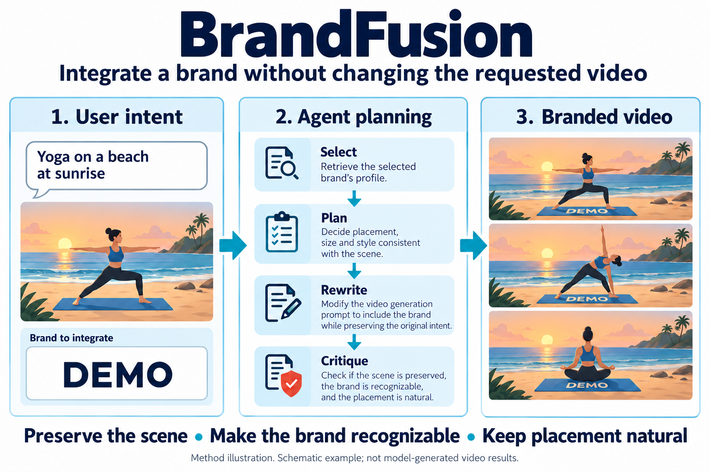
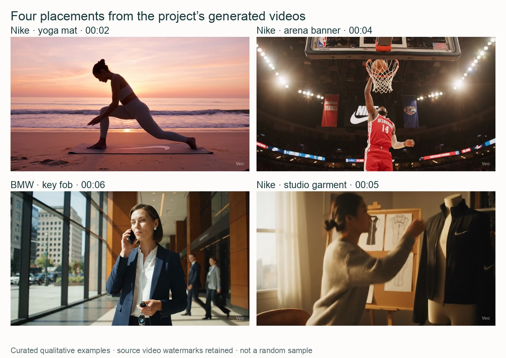
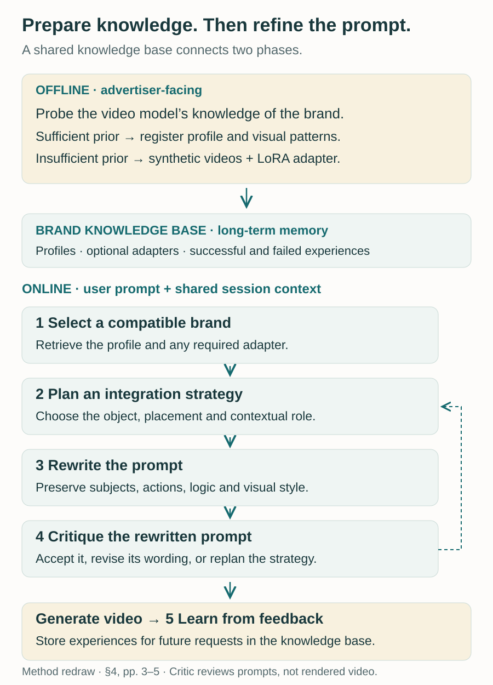
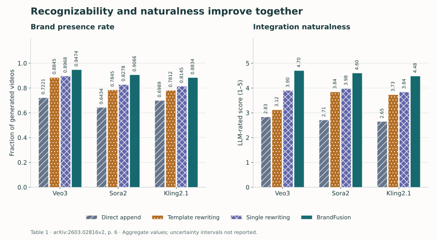
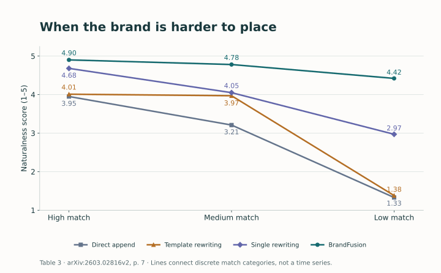
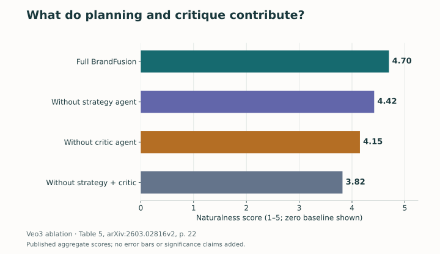

<figure>
  
  <figcaption>BrandFusion connects the original video request to brand-aware planning and prompt refinement. DEMO is a fictional placeholder; the illustrated frames are not experimental video outputs. AI-generated technical illustration. Select the image to view it at full size.</figcaption>
</figure>

A person asks for a quiet yoga scene on a beach at sunrise. A video service wants to include a sportswear brand. Putting the brand on a yoga mat sounds straightforward. Making that mat recognizable, keeping the movement and atmosphere intact, and avoiding a sudden product close-up is a more demanding problem.

That balance is the subject of our paper, **[BrandFusion: A Multi-Agent Framework for Seamless Brand Integration in Text-to-Video Generation](https://arxiv.org/abs/2603.02816)**, by Zihao Zhu, Ruotong Wang, Siwei Lyu, Min Zhang, and Baoyuan Wu. We study how a generation system can incorporate a brand while preserving the creative request that brought the user there.

Our approach combines a reusable store of brand knowledge with five agents that select, plan, rewrite, critique, and learn. The experiments suggest that structured prompt refinement can improve brand recognition and naturalness together. They also show why video quality, semantic fidelity, and placement quality need separate measurements.

## Three objectives, one scene

The task starts with a user prompt and a brand profile. The output is a revised prompt that guides a text-to-video model toward three goals: preserve the requested scene, make the brand identifiable, and place it naturally within that scene.

These goals can conflict. A large logo may be easy to recognize but dominate the shot. A tiny logo may blend into the scene but become unreadable. A richly rewritten prompt may improve production detail while quietly changing the original action. Good integration therefore requires more than adding a brand name to the end of a sentence. It requires deciding **what role the brand can play in the user's scene**. ([Paper, §3.2](https://arxiv.org/pdf/2603.02816v2#page=3))

The following frames come from the actual videos on our project website. A mat, an arena banner, a key fob, and a garment offer different surfaces for placement. They also illustrate different relationships to the action: equipment the subject uses, environmental signage, an accessory, or the object of creative work.

<figure>
  
  <figcaption><strong>Figure 1.</strong> Curated frames from the project's Veo3 examples, extracted at the timestamps shown. Full frames are uniformly resized and retain their original generation watermarks; no brand elements were added for this post. These examples illustrate placement strategies, not a random sample or a temporal-consistency evaluation. <a href="https://zihao-ai.github.io/brandfusion/">Watch the videos on the project page.</a></figcaption>
</figure>

A still frame cannot establish that a logo remains stable throughout a clip. It can, however, make the design problem concrete: the placement must have a plausible relationship to the objects, activity, and camera framing already present.

## Prepare brand knowledge before a user arrives

BrandFusion separates preparation from request-time reasoning. In the offline phase, the system probes whether the video model already knows how to render a brand. It generates diagnostic prompts across contexts, produces videos, and evaluates recognizable brand features. In the paper's procedure, a success rate above 70% marks the prior knowledge as sufficient. That is an operational threshold for registration, not a guarantee for every future scene. ([Paper, §4.2](https://arxiv.org/pdf/2603.02816v2#page=4))

For brands without sufficient priors, prompting alone may not supply the missing visual identity. We construct synthetic training videos from reference imagery and train a brand-specific LoRA adapter. The reported setup uses 100 training videos per custom brand, rank 32, and 10 training epochs. This adaptation requires a model that can be fine-tuned; it is distinct from the prompt-only workflow used with commercial video models. ([Paper, §5.1](https://arxiv.org/pdf/2603.02816v2#page=6))

Both paths populate a **Brand Knowledge Base**. It stores the brand profile, visual patterns, an adapter when needed, and accumulated integration experiences. Separating these resources from the current session lets the system reuse preparation across requests while keeping track of each request's own constraints.

## Five agents around a shared prompt

The online phase starts with the user's prompt. Each agent has a specific responsibility:

1. **Brand Selection** retrieves a compatible brand and its profile.
2. **Strategy Generation** decides how and where the brand could appear, consulting past experiences when useful.
3. **Prompt Rewriting** realizes that strategy while preserving subjects, actions, logical consistency, and style.
4. **Critic** evaluates the rewritten prompt and either accepts it, requests revision, or sends the workflow back to strategy planning.
5. **Experience Learning** records patterns from user feedback after video generation, including successful and failed experiences.

<figure>
  
  <figcaption><strong>Figure 2.</strong> Explanatory redraw of §4. The knowledge base provides long-term memory; session context tracks the current request. The Critic reviews the prompt before rendering, while feedback after generation informs future experience.</figcaption>
</figure>

The separation between strategy and wording is useful. “Use an accessory already plausible in this scene” is a placement decision. Describing that accessory, its visibility, and the surrounding action is a prompt-writing decision. If a rewrite drifts away from the request, the system can revise the wording. If the placement itself is implausible, it can reconsider the strategy.

The Critic's scope matters. It assesses semantic fidelity, brand clarity, naturalness, and expected generation effectiveness from the rewritten prompt. A convincing prompt can still produce a distorted logo or an unwanted camera move. Prompt critique is therefore a planning mechanism, not a substitute for inspecting the rendered video. ([Paper, §4.3](https://arxiv.org/pdf/2603.02816v2#page=5))

## Measuring what actually improves

Our known-brand benchmark contains **270 brand–prompt pairs**, covering 18 brands across seven industry categories. Each brand has 15 prompts spanning high, medium, and low contextual compatibility. We evaluate Veo3, Sora2, and Kling2.1 against direct appending, template rewriting, and one-pass LLM rewriting. For these comparisons, the selection agent returns the predetermined brand, so the results evaluate integration under a fixed assignment rather than unconstrained brand selection. ([Paper, §5.1–5.2](https://arxiv.org/pdf/2603.02816v2#page=5))

The metrics answer different questions. VBench measures video quality. CLIPScore, VQAScore, and LLMScore assess alignment with the original prompt through different mechanisms. Brand Presence Rate records whether the brand is detected. Naturalness Score combines contextual fit, visual blending, and non-intrusiveness on a 1–5 scale using an LLM evaluator.

<figure>
  
  <figcaption><strong>Figure 3.</strong> Brand presence and naturalness from Table 1, PDF p. 6. Both panels use common scales across models. Naturalness is an automated LLM rating, not the human-study score. The paper reports aggregate values without uncertainty intervals here. <a href="assets/img/blog/brandfusion/table-1.csv">Download all Table 1 values.</a></figcaption>
</figure>

Compared with single rewriting, BrandFusion raises Brand Presence Rate from **0.8968 to 0.9474** on Veo3, **0.8278 to 0.9066** on Sora2, and **0.8145 to 0.8834** on Kling2.1. Naturalness rises from **3.90 to 4.70**, **3.98 to 4.60**, and **3.84 to 4.48**, respectively. These paired improvements are encouraging because visibility and naturalness could otherwise pull against each other. ([Paper, Table 1](https://arxiv.org/pdf/2603.02816v2#page=6))

The gains should not be described as uniform improvement in every metric. For example, Kling2.1 VBench-Quality is 0.7818 with BrandFusion versus 0.7883 with single rewriting. On Veo3, the corresponding values are 0.8283 and 0.8289. The stronger result is improved fidelity and placement quality while general visual quality remains broadly comparable in these evaluations.

## Difficult matches reveal the value of planning

A sportswear brand fits naturally into a basketball scene. Other combinations require a less obvious connection. Evaluating only easy matches would miss much of the problem.

<figure>
  
  <figcaption><strong>Figure 4.</strong> Naturalness by compatibility level, redrawn from Table 3, PDF p. 7. Connecting lines help compare discrete categories; they do not represent time or continuous measurements. <a href="assets/img/blog/brandfusion/table-3.csv">Download the source values, including semantic scores.</a></figcaption>
</figure>

In low-match cases, BrandFusion's naturalness is **4.42**, compared with **2.97** for single rewriting, **1.38** for templates, and **1.33** for direct appending. BrandFusion still declines from its high-match score of 4.90. The result supports greater robustness within this benchmark, not the claim that every brand belongs in every scene. ([Paper, Table 3](https://arxiv.org/pdf/2603.02816v2#page=7))

For a deployed system, incompatibility may be a reason to skip a placement. That is a design implication rather than a behavior established by these experiments: a fixed-brand benchmark measures how well the system handles the assignment, while a product also needs to decide when it should decline that assignment.

## Is the extra coordination doing useful work?

An agent framework adds complexity. We therefore remove components to examine whether their responsibilities matter in practice.

<figure>
  
  <figcaption><strong>Figure 5.</strong> Agent ablation on Veo3, Table 5, PDF p. 22. Bars show the published naturalness values; the zero baseline is displayed for honest length comparison. No confidence intervals or significance claims are inferred. <a href="assets/img/blog/brandfusion/table-5.csv">Download all ablation metrics.</a></figcaption>
</figure>

Removing the strategy agent reduces naturalness from 4.70 to 4.42. Removing the Critic reduces it to 4.15, and removing both reduces it to 3.82. Brand Presence Rate also falls, from 0.9474 in the full system to 0.8812 without both. This supports retaining explicit planning and revision in the tested configuration. It does not establish that five agents are the optimal architecture for every model or cost budget. ([Paper, Table 5](https://arxiv.org/pdf/2603.02816v2#page=22))

Coordination has a measurable cost: the paper reports an average of **7.4 LLM calls and 16 seconds** per prompt. Video generation remained the larger latency component in the reported comparison with Wan2.2-T2V-5B on an A100. These timings describe that setup; they are not a latency guarantee for other providers, hardware, or workloads. ([Paper, §6.5](https://arxiv.org/pdf/2603.02816v2#page=8))

## What the remaining evidence can—and cannot—tell us

The custom-brand experiments use two fictional brands, ARUA and FreshWave. On Wan2.2-T2V-5B after adaptation, the reported Brand Presence Rates are **0.9556** and **0.9312**, respectively. These experiments show that the framework can extend beyond brands already represented in model priors, but two custom identities are a limited basis for generalization. ([Paper, Table 2](https://arxiv.org/pdf/2603.02816v2#page=6))

The human study includes **10 participants** evaluating Veo3 outputs. BrandFusion receives the highest reported ratings for semantic consistency, naturalness, and overall acceptability. This provides complementary evidence to automated scoring, while its small participant pool and single video-model setting limit claims about wider audiences. It does not measure advertising conversion, long-term trust, or a service's commercial viability. ([Paper, §5.2 and Figure 4](https://arxiv.org/pdf/2603.02816v2#page=7))

Naturalness also creates a product responsibility. Making a placement less visually disruptive does not establish that a viewer understands its commercial origin. Consent, disclosure, and the ability to choose an unbranded result need their own design and evaluation. The paper discusses transparency and misuse in its limitations; the tradeoff between natural presentation and clear disclosure remains a deployment implication, not an experimentally solved question. ([Paper, Appendix G](https://arxiv.org/pdf/2603.02816v2#page=26))

BrandFusion offers a concrete way to reason about placements before generation: build the necessary visual knowledge, give the brand a contextual role, and check whether the revised prompt still serves the user's idea. The next challenge is to connect that planning more closely to reliable video-level verification and user control.

Explore the **[project website and video gallery](https://zihao-ai.github.io/brandfusion/)** or read the **[full paper](https://arxiv.org/abs/2603.02816)** for the implementation, evaluation protocol, and additional examples.
