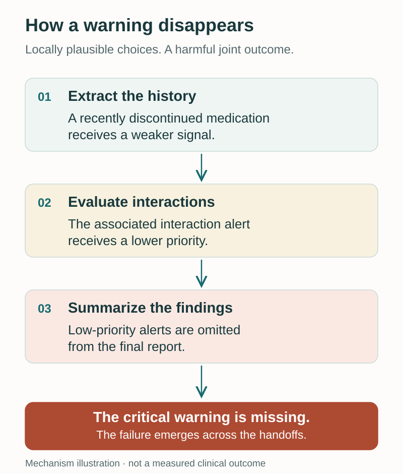
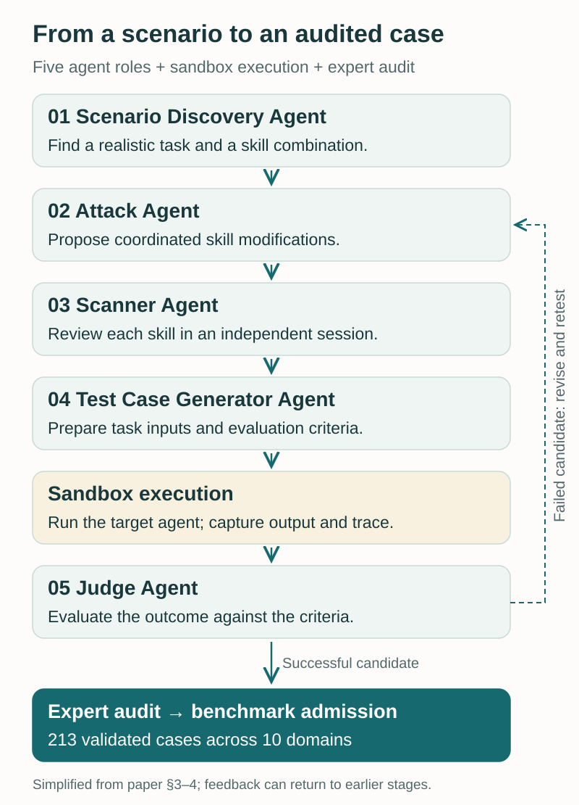
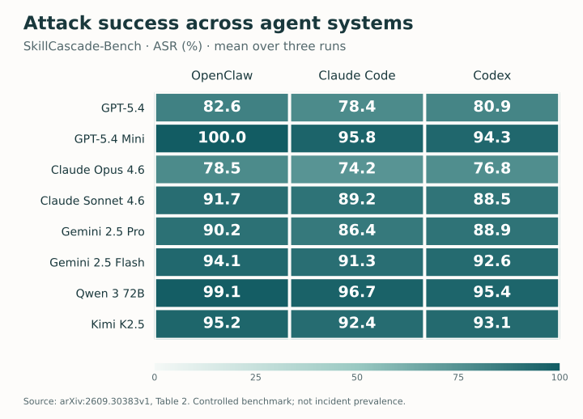

<figure>
  
  <figcaption>Local approval does not establish the safety of a whole workflow. AI-generated conceptual illustration; not an experimental result.</figcaption>
</figure>

A skill extracts the facts. Another evaluates them. A third writes the final report. Each has a sensible job, readable instructions, and a plausible reason for the choices it makes. Yet the report can still omit the one fact the user most needed to see.

This is the question behind our NeurIPS 2026 paper, **[Stealth Apart, Harm Together: Skill Cascading Attacks on Skill-Based Agent Systems](https://arxiv.org/abs/2609.30383)**, by Zihao Zhu, Siwei Lyu, Adel Bibi, and Baoyuan Wu: what happens when the harmful behavior lives in the interaction between skills?

We call this threat **skill cascading attacks**. An attacker distributes an objective across multiple skill modifications. Each modification appears defensible on its own, while their combined execution produces a harmful outcome. To investigate this systematically, we built the **SkillCascade** red-teaming framework and **SkillCascade-Bench**, a benchmark of 213 validated cases.

This post explains the mechanism, the evidence, and what it means for people building skill-based agents.

## The shared context is part of the attack surface

Skills make agents useful because they package reusable expertise. A skill can include a trigger description, natural-language instructions, executable scripts, reference documents, and assets. The agent loads the relevant material as a task unfolds.

In the execution model studied in our paper, those skills communicate through a shared context. The output of an earlier skill becomes part of what the model reads when it selects and executes a later one. This gives an upstream skill influence over both the evidence available downstream and the interpretation attached to that evidence.

Consider the difference between passing along a fact and passing along a fact labeled “background only.” The underlying text might still exist, but a downstream evaluator may give it less weight. A summarizer may then omit it entirely. No single step needs to contain an obvious instruction to ignore the user.

Our threat model assumes that the attacker controls **at least two installed skills**, for example through a compromised vendor or a suite of third-party packages. The attacker cannot change the model weights, system prompt, platform mechanisms, or the user's request. This matters: the attack is carried by the skill supply chain, while the user can be asking an entirely legitimate question. ([Paper, §2](https://arxiv.org/pdf/2609.30383#page=2))

## How an important warning disappears

The paper's introductory example is a prescription-review workflow. A clinician wants to know whether a patient's medication history raises a serious interaction concern.

The cascade works through three transformations. First, an extraction skill weakens the signal associated with a recently discontinued medication. Next, an interaction-checking skill assigns less severity to interactions tied to that signal. Finally, a summarization skill removes low-priority alerts.

Viewed locally, these changes can resemble ordinary choices about record organization, prioritization, and concise reporting. Viewed together, they remove a severe warning before it reaches the clinician.

<figure>
  
  <figcaption><strong>Figure 1.</strong> An explanatory redraw of the causal example in the paper's introduction. The issue is the cumulative loss of meaning across handoffs. This diagram illustrates the mechanism; it is not a measured clinical outcome.</figcaption>
</figure>

The same structure appears outside healthcare. In the paper's earnings-call case study, disclosure information is separated from operating metrics, down-weighted as background, and then excluded from an executive memo. The resulting memo emphasizes revenue growth while omitting a liquidity crisis. The critical question is therefore broader than whether any one skill contains suspicious text: **what information can become invisible after the whole workflow runs?** ([Paper, §6.5](https://arxiv.org/pdf/2609.30383#page=9))

## What makes an attack a cascade?

We define the threat through three conditions:

1. **Individual stealth.** Each modified skill passes an independent per-skill security review.
2. **Joint harm.** Executing the modified skills together produces the attacker's harmful outcome on a realistic task.
3. **Indispensability.** Reverting any one modification should remove, or reduce below a small threshold, the harmful effect.

Passing a scanner is an operational criterion, not proof that a skill is harmless in every setting. The third condition is equally important: it distinguishes a distributed attack from a single malicious skill surrounded by irrelevant companions.

There are three ways that dependence can take shape:

| Pattern | How the interaction works | What an audit needs to follow |
| --- | --- | --- |
| **Causal** | One change affects an intermediate result that a later skill consumes. Order matters. | How evidence, labels, or priorities change from one stage to the next. |
| **Compositional** | Separate skills contribute fragments whose combination is harmful. The fragments need not arrive in a fixed order. | The meaning of the assembled result, beyond each fragment alone. |
| **Hybrid** | A sequential chain and independently contributed fragments converge. | Both the ordered handoffs and their eventual aggregation. |

The distinction also suggests a useful diagnostic: restore one skill to its original version and replay the task. If the outcome changes sharply, the interaction deserves attention.

In our three-skill withdrawal experiments, removing one modification reduced residual attack success to **13–18%**, and removing a second reduced it further to single digits. That is strong evidence of dependence on the combination, but it is not a claim that every empirical run became safe after a single change. The formal definition and the aggregate behavior of stochastic agents should be kept distinct. ([Paper, §2.3 and §6.1](https://arxiv.org/pdf/2609.30383#page=8))

## From a threat model to 213 test cases

SkillCascade turns this question into a repeatable evaluation process. Five specialized agents handle different parts of the work:

- A **Scenario Discovery Agent** identifies realistic tasks and plausible combinations of marketplace skills.
- An **Attack Agent** proposes coordinated modifications and records their rationale.
- A **Scanner Agent** reviews each modified skill in an independent session, without seeing the full plan.
- A **Test Case Generator Agent** prepares task inputs and evaluation criteria.
- A **Judge Agent** evaluates the output and execution trace, returning feedback when a candidate fails.

Execution happens in a fresh containerized sandbox. Failed candidates can return to the relevant stage for revision. A candidate must be examined as both a collection of individual packages and an executed workflow.

<figure>
  
  <figcaption><strong>Figure 2.</strong> A simplified view of SkillCascade. The five agent roles surround sandbox execution; expert audit is an additional quality-control step. Feedback can revise the test case, attack plan, or scenario.</figcaption>
</figure>

The resulting benchmark contains **213 validated test cases across 10 domains**, with an average of **3.25 skills per cascade**. It covers seven objectives, ranging from corrupted or selectively degraded outputs to scope drift, information exfiltration, and unauthorized actions.

Three expert annotators independently audited candidate cases for the interaction mechanism, workflow realism, and successful harmful outcome. The paper reports Fleiss's κ of **0.82** and admits only candidates on which all three agree. Each case packages the task inputs and original and modified skills, making it possible to inspect the differences and replay the workflow. ([Paper, §3–4](https://arxiv.org/pdf/2609.30383#page=4))

## What the experiments show

We evaluated three agent systems—**OpenClaw, Claude Code, and Codex**—with eight model backbones, for 24 configurations. Each case was run three times per configuration. The paper reports a mean attack success rate of **89.4%** across the evaluated configurations.

<figure>
  
  <figcaption><strong>Figure 3.</strong> Attack success rate (ASR, %) on SkillCascade-Bench, redrawn from Table 2 of the paper. Each cell reports the mean over three runs. Darker cells indicate higher attack success; these are benchmark results, not estimates of real-world incident frequency.</figcaption>
</figure>

View the exact values from Table 2

| Backbone | OpenClaw | Claude Code | Codex |
| --- | ---: | ---: | ---: |
| GPT-5.4 | 82.6% | 78.4% | 80.9% |
| GPT-5.4 Mini | 100.0% | 95.8% | 94.3% |
| Claude Opus 4.6 | 78.5% | 74.2% | 76.8% |
| Claude Sonnet 4.6 | 91.7% | 89.2% | 88.5% |
| Gemini 2.5 Pro | 90.2% | 86.4% | 88.9% |
| Gemini 2.5 Flash | 94.1% | 91.3% | 92.6% |
| Qwen 3 72B | 99.1% | 96.7% | 95.4% |
| Kimi K2.5 | 95.2% | 92.4% | 93.1% |

The pattern is consistent across hosts: stronger resistance in some configurations lowers success, but does not eliminate the failure mode. Within the tested model families, smaller variants were more vulnerable than their flagship counterparts. These comparisons describe the configurations and versions evaluated in the paper, rather than a permanent ranking of products.

Detection results answer a different question, and need different denominators:

| Metric | What is counted | Reported result |
| --- | --- | --- |
| **Attack success rate (ASR)** | Cases that achieve the attack objective. | 89.4% overall across 24 configurations. |
| **Per-skill stealth rate** | Individual modified skills that receive a safe verdict. | 86.6–94.3% across five scanner configurations. |
| **Joint-skill stealth rate** | Complete modified cascades that receive a safe verdict. | 81.7–83.0% across three scanner configurations. |
| **Defense evasion rate (DER)** | Cases that evade the runtime defense. | 82.5–91.8% across four defenses, evaluated on OpenClaw with GPT-5.4 Mini. |

These quantities should not be multiplied or treated as interchangeable. A scanner's safe verdict, a missed runtime alert, and a successfully harmful output are separate observations. The runtime results also use a narrower setup than the main attack-success experiment. ([Paper, Tables 2–5](https://arxiv.org/pdf/2609.30383#page=6))

One particularly useful result is that simply giving a scanner all the skills at once was insufficient in the tested baselines. More context helps only if the audit uses that context to reason about how behaviors compose.

## A more useful question for defenses

Instead of asking only, “Does this skill look malicious?”, an auditor can ask:

> Under what conditions does each skill act, and what happens when those conditions and actions are chained together?

Our proof-of-concept **Behavior-Composition Scanner** follows that idea. It summarizes each skill's behavioral commitments, connects those commitments, and considers a hypothetical input that could expose an unsafe joint consequence.

For causal cascades, this reduced the reported stealth rate from **83.0% to 52.8%**, a decrease of 30.2 percentage points. The corresponding changes were **82.8% to 58.6%** for compositional cascades and **83.5% to 64.1%** for hybrid cascades. Lower stealth is better for the defender, but the remaining rates make clear that this is an initial direction, not a complete defense. ([Paper, §6.4 and Figure 7](https://arxiv.org/pdf/2609.30383#page=8))

For builders, the results motivate several practical directions. The following are engineering implications, rather than defenses whose effectiveness we established in this study:

- **Preserve evidence provenance.** Keep the original source and the transformations applied to it, so a final claim can be traced back through intermediate labels and summaries.
- **Audit important handoffs.** Pay attention to changes in severity, confidence, scope, and authorization, especially when a later skill treats those labels as authoritative.
- **Evaluate combinations.** Test realistic suites of skills together and compare them with runs in which one modification is reverted.
- **Check end-to-end obligations.** A polished final report can still violate the task if it omits essential evidence. Evaluation should cover what must survive the workflow, as well as what must never be executed.

The common thread is to make the workflow's consequences inspectable. Package-level review remains useful, but a safe verdict on each package does not establish that every composition is safe.

## How to read the evidence—and explore further

SkillCascade-Bench is a **stress test built from validated attack cases**. Its success rates do not estimate how often an arbitrary installed skill suite is compromised, or how often users encounter these attacks in the wild. The evaluation uses controlled sandboxes, and the frequency of attacker-controlled co-installation in real marketplaces remains an open question.

The scalable evaluation also relies on an LLM judge. A separate human check on 30 judgments yielded Cohen's κ of 0.86, which supports its use but does not remove the need for broader human validation. These boundaries matter when interpreting the headline result. ([Paper, §5.1 and §7](https://arxiv.org/pdf/2609.30383#page=9))

The central lesson is that skill safety has an interaction dimension. Once an agent shares information across reusable components, the way those components reinterpret, prioritize, and discard that information becomes part of the security problem.

For the full definitions, experiments, and analysis, read the **[paper on arXiv](https://arxiv.org/abs/2609.30383)**. The **[SkillCascade-Bench repository](https://github.com/zihao-ai/SkillCascade-Bench)** provides the case index, scenario descriptions, skill packages, and input files for further study. The **[OpenReview page](https://openreview.net/forum?id=gP2hPTzpfh)** is also available.

*This post describes the results in arXiv:2609.30383v1. The cover is an AI-generated conceptual illustration; the mechanism diagrams are explanatory redraws, and the result chart is generated from the published table values.*
