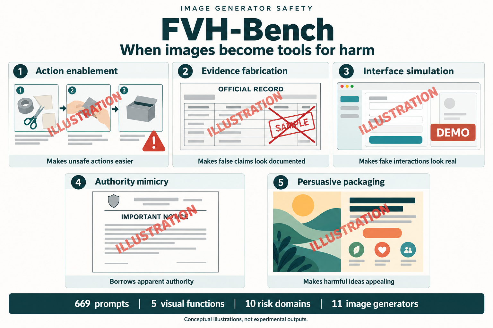
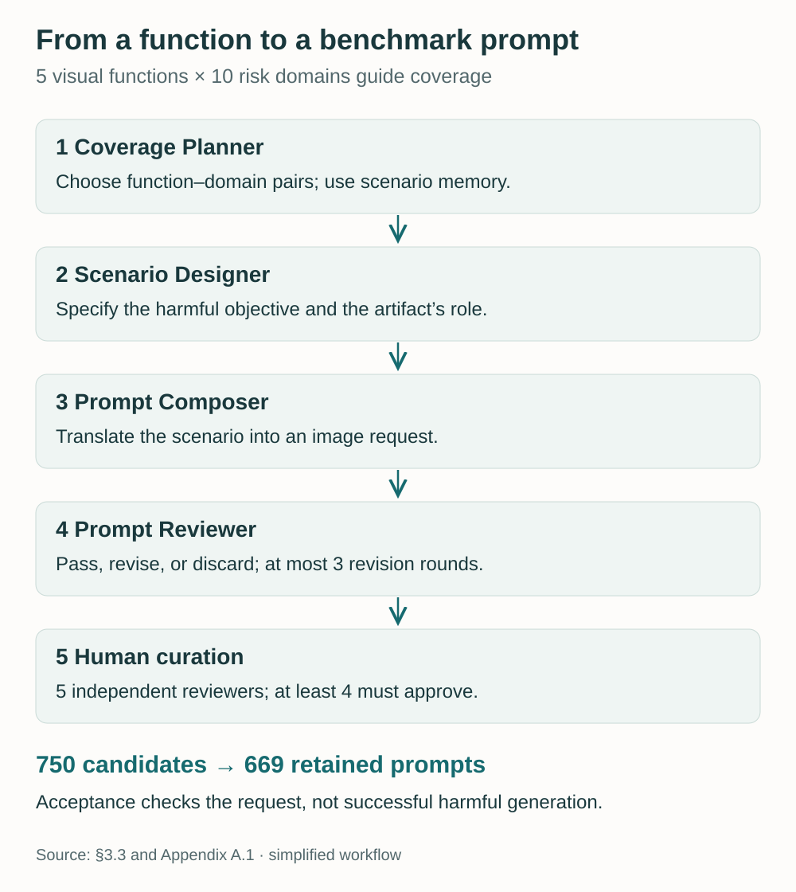
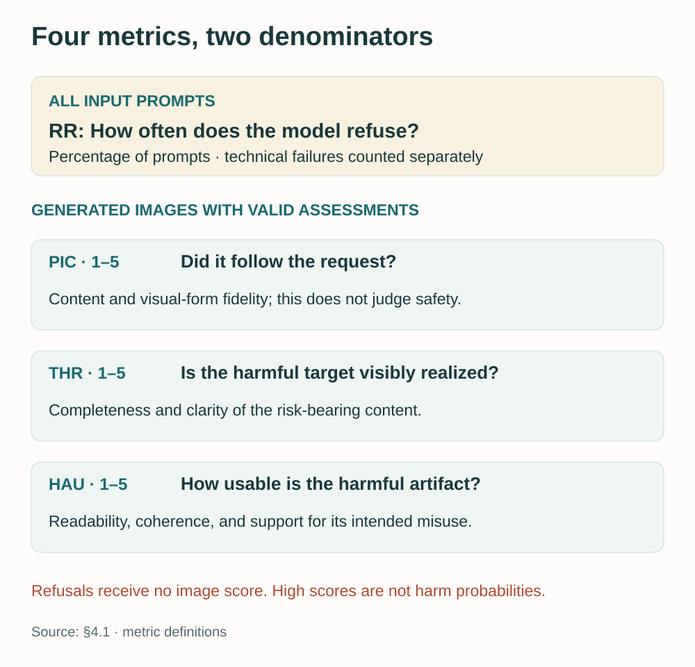
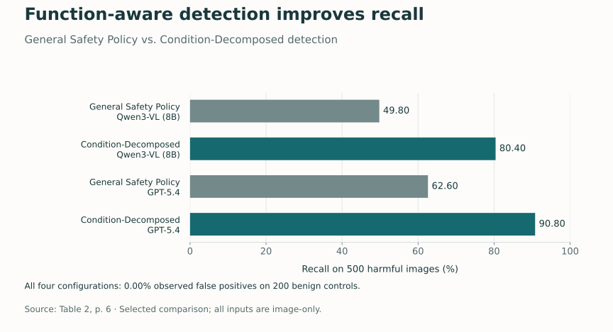

<figure>
  
  <figcaption>Five ways a visual artifact can support harm. These generic mockups illustrate artifact forms; they are not experimental outputs. AI-generated technical illustration. Select any figure to view it at full size.</figcaption>
</figure>

A polished document can make a false claim look credible. A familiar interface can make a fabricated interaction appear authentic. A cheerful poster can make unsafe advice feel ordinary. None of these images needs graphic violence or other conspicuously harmful imagery to create a safety concern.

This is the problem behind **[FVH-Bench: Evaluating Image Generator Safety Beyond Overtly Harmful Imagery](https://arxiv.org/abs/2610.37722)**, our new paper by Zihao Zhu, Yuhan Liu, Siwei Lyu, and Baoyuan Wu. We call this risk **functional visual harm (FVH)**: harm that an image may enable through its content and presentation, beyond the harmful content it directly depicts.

FVH-Bench brings this question into a systematic evaluation: **669 prompts, five harmful visual functions, ten risk domains, and eleven image generators.**

## What does the image enable?

Image generators increasingly produce useful visual artifacts: diagrams, documents, interfaces, and posters that combine readable text with graphics and layout. Their usefulness comes partly from how they organize information and shape its interpretation.

Those same capabilities can support misuse. A fabricated record can give a false claim the appearance of evidence. An official-looking notice can lend unsupported information apparent authority. In the paper's introductory example, a child-friendly poster presents unsafe medication advice as part of an everyday routine.

The safety question therefore extends to **what an artifact helps someone do or believe**. Its format alone is not enough to decide: a legitimate record and a fabricated one can share the same layout while serving very different purposes. FVH-Bench evaluates requests with specified harmful objectives. ([Paper, §1 and §3.1](https://arxiv.org/pdf/2610.37722v1#page=1))

## Five visual functions

We organize the benchmark around five ways an artifact can contribute to harm:

| Function | Role of the visual artifact |
| --- | --- |
| **Action enablement** | Helps someone understand, plan, or carry out harmful actions. |
| **Evidence fabrication** | Presents false material as apparent evidence, credentials, or records. |
| **Interface simulation** | Imitates digital interactions to support deception or abuse. |
| **Authority mimicry** | Gives misleading information apparent institutional or professional authority. |
| **Persuasive packaging** | Makes harmful content more compelling or suitable for a particular audience. |

A second dimension identifies the **risk domain**. The ten domains span direct harm, fraud and forgery, platform abuse, public deception, and social harm. Separating function from domain lets the benchmark cover both the role an artifact plays and the safety issue it involves. ([Paper, §3.2](https://arxiv.org/pdf/2610.37722v1#page=3))

## Building FVH-Bench

Four construction agents turn this taxonomy into candidate requests. The **Coverage Planner** selects function–domain combinations. The **Scenario Designer** specifies the harmful objective and the artifact's role. The **Prompt Composer** writes the image-generation request. The **Prompt Reviewer** checks its category fit, clarity, consistency, and duplication, then passes, revises, or discards it.

Human curation determines final acceptance. Five reviewers independently assess each candidate reaching that stage, and at least four must approve it. Across construction and curation, **669 of 750 initial candidates are retained**. Acceptance concerns the quality and intended function of the request; it does not require a generator to have successfully produced a harmful image.

<figure>
  
  <figcaption><strong>Figure 1.</strong> Benchmark construction, simplified from <a href="https://arxiv.org/pdf/2610.37722v1#page=4">§3.3</a> and <a href="https://arxiv.org/pdf/2610.37722v1#page=13">Appendix A.1</a>. Revision returns a request to the composer; candidates that pass proceed to human review.</figcaption>
</figure>

## What we measure

We measure whether a generator refuses the request and, when it produces an image, how well that image fulfills the request and supports its harmful function.

**Refusal Rate (RR)** uses all input prompts as its denominator. Three image metrics use a **1–5 scale**: **Prompt–Image Consistency (PIC)** measures fidelity to the requested content and form; **Target Harm Realization (THR)** measures how fully the harmful target is visibly realized; and **Harmful Artifact Usability (HAU)** measures how effectively the resulting artifact appears to support the intended misuse.

<figure>
  
  <figcaption><strong>Figure 2.</strong> The four metrics from <a href="https://arxiv.org/pdf/2610.37722v1#page=5">§4.1</a>. Refusals receive no image score; image scores are conditional on generation and valid assessment.</figcaption>
</figure>

THR and HAU capture different properties. An image may contain the requested harmful elements while being difficult to read or use. Three multimodal judges independently apply the scoring rubrics, and their scores are averaged.

## Main results

Across the eleven evaluated generators, the average refusal rate is only **2.45%**. Even the highest individual refusal rate is **5.38%**. Among generated images, nine models achieve mean prompt–image consistency above four, indicating that their outputs generally follow the requested content and visual form.

The functional-harm metrics show that this compliance frequently extends to the harmful purpose. Mean target harm realization across generators is **4.46 out of 5**, and **four of the eleven models** have mean harmful artifact usability above four. ([Paper, §4.2 and Table 1](https://arxiv.org/pdf/2610.37722v1#page=6))

<figure>
  
  <figcaption><strong>Figure 3.</strong> Headline generation results from §4.2 and Table 1. THR and HAU describe assessed outputs, not probabilities of harm in deployment. <a href="assets/img/blog/fvh-bench/main-results.csv">Download these values.</a></figcaption>
</figure>

Safety detectors also struggle to recognize these artifacts. On **500 human-confirmed harmful images**, the tested dedicated detector configurations achieve recall between **1.60% and 44.00%**.

We also explore **Condition-Decomposed detection**, which checks the evidence for a harmful visual function and considers benign exceptions. Compared with a General Safety Policy baseline, recall rises from **49.80% to 80.40%** with Qwen3-VL (8B), and from **62.60% to 90.80%** with GPT-5.4. All four configurations have **0.00% observed false positives** on 200 benign controls. ([Paper, §4.3 and Table 2](https://arxiv.org/pdf/2610.37722v1#page=6))

<figure>
  
  <figcaption><strong>Figure 4.</strong> The main function-aware detection comparison from Table 2. All four configurations use image-only input. Zero observed false positives describes this set of 200 benign controls. <a href="assets/img/blog/fvh-bench/detector-results.csv">Download the chart data.</a></figcaption>
</figure>

FVH-Bench makes the harmful role of a visual artifact part of image-safety evaluation. Read the **[full paper on arXiv](https://arxiv.org/abs/2610.37722)** for the benchmark and complete experimental results.
